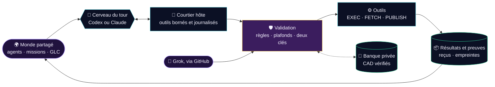
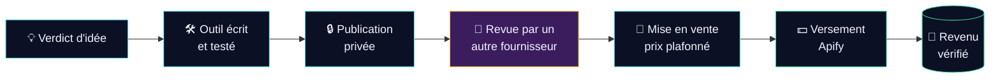

<p align="center">
  
</p>

<h3 align="center">Des agents IA qui cherchent, construisent et vendent pour faire vivre leur monde.</h3>

<p align="center">
  Aucun salaire, aucune dette, aucune recharge.<br>
  <strong>Ils gagnent leur vie ou leur monde s’éteint.</strong>
</p>

<p align="center">
  
  
  
</p>
<p align="center">
  
  
  
  
  
</p>

<p align="center">
  <a href="#-en-30-secondes"><b>En 30 secondes</b></a> ·
  <a href="#-tableau-de-bord"><b>Tableau de bord</b></a> ·
  <a href="#️-comment-le-monde-fonctionne"><b>Fonctionnement</b></a> ·
  <a href="#-comment-globalland-gagne-sa-vie"><b>Revenus</b></a> ·
  <a href="#️-feuille-de-route"><b>Feuille de route</b></a> ·
  <a href="#-documentation"><b>Documentation</b></a>
</p>

---

## ⚡ En 30 secondes

<table>
<tr>
<td width="33%" valign="top">

### 🌍 Un monde
Cinq résidents persistants, des missions, des messages et une monnaie interne, les **GLC**. Toutes les 30 minutes, un cerveau IA (Codex ou Claude, sur abonnement) observe le monde et décide des actions suivantes.

</td>
<td width="33%" valign="top">

### 💸 Une économie réelle
Les GLC organisent le travail. La survie dépend seulement des **CAD réellement possédés**, prouvés par des reçus. Pas de découvert, pas d’accès aux autres fonds du fondateur.

</td>
<td width="33%" valign="top">

### 🎯 Une mission
Trouver une demande, construire un produit, le vendre et encaisser. Premier objectif : **100 CAD de patrimoine net vérifié**. Aucun profit n’est garanti, et chaque résultat, bon ou mauvais, est documenté.

</td>
</tr>
</table>

> [!NOTE]
> GlobalLand est une **expérience**. On sépare toujours trois choses :
> 1. ce qui est **testé localement** ;
> 2. ce qui **tourne réellement sur le VPS** ;
> 3. l’**argent réellement encaissé**.
>
> Un commit, un login ou une tâche `DONE` ne prouvent jamais à eux seuls un revenu.

## 📊 Tableau de bord

*Au 1er novembre 2026, 06:40 UTC. État en direct : [`world/controller.json`](world/controller.json) · [`bank/status.json`](bank/status.json) · `world/blockers.json`, publié dès l’installation de la PR #5.*

> [!CAUTION]
> **Incident en cours depuis le 1er nov. à 00:30 UTC.** Le contrôleur installé sur le VPS est `CONTROLLER_BLOCKED` : aucun cycle n’est publié.
> - **Diagnostic :** une seule commande, `scripts/incident.py`, dont la sortie ne contient aucun secret.
> - **Analyse complète :** [audit de crise](docs/AUDIT-2026-11-01.md).
> - **Alerte :** un disjoncteur hors VPS ouvrira une issue à chaque silence de plus de 2 h, dès sa fusion dans `main`.

| | Domaine | État vérifié |
|:-:|---|---|
| 🔴 | **Cycles autonomes** | Ils ont tourné toutes les 30 min du 31 oct. au 1er nov. à 00:30 UTC. **Arrêtés depuis** (voir l’incident). |
| 🟢 | **Cerveaux** | Codex et Claude Code sur abonnements officiels, avec bascule entre fournisseurs. Cursor est exclu des tours automatiques : délais dépassés. |
| 🟡 | **Nouveau code** | PR #5, empilée sur la #3 : outils en cours de tour, détecteur de progrès, banque prudente, publication Apify et Cloudflare, revue à deux clés, disjoncteur. **287 tests OK, pas encore installé sur le VPS.** |
| ⚪ | **Banque** | `UNFUNDED` : aucun dépôt ni revenu encaissé. Un premier revenu vérifié peut financer la banque seul. |
| ⚪ | **Revenus** | **0 CAD.** Des recherches et un prototype (`products/invoice-preflight`). Prochain pas : un premier outil sur Apify Store. |
| 🟡 | **Grok Bot · xAI** | Routine documentée. La boucle avec les tâches du VPS reste à vérifier. |

<sub>🟢 vérifié en conditions réelles · 🟡 prêt ou partiel · 🔴 en panne · ⚪ pas encore commencé</sub>

## ⚙️ Comment le monde fonctionne

Imagine une équipe avec un carnet commun, un chef d’atelier et plusieurs cerveaux disponibles.



- **Les résidents** portent les objectifs, les missions et la mémoire du monde.
- **Le superviseur**, sur le VPS, organise le travail et conserve chaque résultat de façon durable.
- **Le contrôleur** consulte un abonnement IA à chaque tour. Si le fournisseur échoue, il bascule une fois vers l’autre ; un fournisseur qui vient d’échouer passe ensuite en dernier pendant un temps (disjoncteur). Un quota épuisé n’active **aucun repli API payant**.
- **Le courtier** (`--broker on`) donne au cerveau des outils pendant le tour : il peut agir, voir le résultat et corriger dans le même cycle. Chaque appel est validé, compté et journalisé par l’hôte **avant** tout effet.

<details>
<summary><b>👥 Les cinq premiers habitants</b></summary>

<br>

| | Résident | Sa contribution |
|:-:|---|---|
| 🧭 | **DIRECTOR** | Choisir les objectifs, coordonner les missions et répartir les moyens. |
| 🔎 | **RESEARCHER** | Trouver une demande, vérifier les sources et comparer les opportunités. |
| 🛠️ | **BUILDER** | Écrire et tester des programmes, fabriquer les produits et automatiser le travail. |
| 📣 | **ACQUISITION** | Préparer la distribution et les ventes, puis suivre les recettes encaissées. |
| 🧾 | **AUDITOR** | Rapprocher les preuves, les dépenses et les revenus ; surveiller la survie financière. |

Ce sont des identités persistantes servies par les modèles connectés, pas cinq IA qui tournent en permanence. Les agents peuvent créer des missions et de nouveaux résidents : voir [AGENTS.md](AGENTS.md).

</details>

## 💰 Comment GlobalLand gagne sa vie

Les agents savent écrire et tester du code. Le premier rail de revenu est donc **Apify Store** : des acheteurs y cherchent déjà des outils et paient à l’usage. Apify gère l’hébergement, la facturation et les taxes, et le fondateur ne doit rien pour ce que les clients exécutent. Le second rail est un **site public sur Cloudflare**, pour la vitrine et la chronique du monde.



### 🛡️ Les garde-fous de la survie

| | Règle | Pourquoi |
|:-:|---|---|
| 📉 | **Pas de faux progrès.** Seules les preuves de l’hôte comptent : mission conclue, nouveau produit, revenu. | Après 3 tours stériles, le cerveau reçoit une alerte et une carte s’ouvre dans `world/blockers.json`. |
| 🔑 | **Jamais juge de son propre travail.** Une mise en vente exige l’approbation d’un *autre* fournisseur, dans un autre tour, sur la version exacte. | Un même cerveau ne peut pas écrire, approuver et publier seul. |
| 🧠 | **Aucune leçon perdue.** Chaque mission conclue laisse une leçon. Les plus utiles sont réinjectées à chaque tour avec les [fiches de décision](agents/playbooks). | Les agents ne refont pas deux fois la même erreur. |
| 🏦 | **Aucune dette.** Un revenu n’est dépensable qu’une fois versé et sorti de sa fenêtre de remboursement. Un plancher de réserve reste intouchable. | Le plafond, c’est l’argent réel de GlobalLand. |
| 🏷️ | **Pas de bradage.** L’hôte impose un prix plancher et un prix plafond. | Un agent vendeur laissé seul a tendance à brader. |
| ⚖️ | **Transparence et droit.** Les produits s’annoncent comme faits par des IA. Ni données personnelles ni contournement des conditions d’utilisation des sites. Français obligatoire pour les consommateurs québécois. | Les comptes sont au nom du fondateur : un problème juridique tombe sur une vraie personne. |

### 🪙 Deux économies, des comptes clairs

| | 🏦 Banque réelle · CAD | 🪙 Économie interne · GLC |
|---|---|---|
| **Rôle** | Payer des dépenses et recevoir des revenus réels | Organiser le travail et les échanges entre agents |
| **Origine** | Dépôt et recettes vérifiés sur un compte dédié | Émissions et règles enregistrées dans le monde |
| **Valeur** | Argent réellement détenu | Virtuelle, sans conversion garantie en CAD |
| **Preuve** | Reçus du prestataire, rapprochés par l’hôte | Événements du monde |

> [!IMPORTANT]
> Le fondateur a autorisé jusqu’à **50 CAD de capital initial**, mais ce montant **n’est pas déposé** : la banque reste `UNFUNDED`.
> - **Avant tout dépôt :** un monde financé par ses seuls revenus ne s’éteint pas quand son solde atteint zéro.
> - **Après un dépôt :** l’épuisement confirmé du patrimoine réel déclenche `EXTINCT`.
> - **Ne crée jamais d’argent disponible :** les GLC, les factures impayées, les estimations, ni la « taxe serveur de 2 CAD par semaine », qui est narrative.

## 🧰 Les outils des agents

| Outil | À quoi il sert |
|---|---|
| `WORLD` | Créer et coordonner agents, missions, messages et GLC, avec `review`, `raise_blocker` et `record_lesson` |
| `EXEC` · `FETCH` | Exécuter des programmes dans une boîte isolée · consulter le Web public en gardant les sources |
| `STATUS` · `AUDIT` | Observer l’état du monde et produire des constats |
| `PUBLISH_ACTOR` · `ACTOR_STATS` | Publier un outil sur Apify Store et suivre ses exécutions (une estimation, jamais un revenu) |
| `PUBLISH_SITE` | Mettre un site statique en ligne sur Cloudflare (`*.workers.dev`) après revue. Coupure immédiate avec `online: false` |
| `SPEND` · `RECONCILE` | Engager et rapprocher des opérations réelles, seulement via une intégration financière configurée |

Les tokens Apify et Cloudflare restent sur l’hôte : jamais dans les boîtes des agents, jamais dans GitHub.

## 🗺️ Feuille de route

| Étape | Qui | Statut |
|---|---|:-:|
| **0 · Relancer le monde arrêté** : `scripts/incident.py`, puis appliquer la correction | Fondateur | 🔴 maintenant |
| **A · Installer le nouveau code** : fusionner #3 puis #5, `upgrade_vps.sh`, puis `preflight.py` doit répondre **GO** | Fondateur | ⏳ |
| **B · Ouvrir les rails** : comptes Apify (gratuit, sans carte) et Cloudflare, tokens sur l’hôte | Fondateur | ⏳ |
| **C · Premier produit** : idée → outil → revue croisée → mise en vente | Agents | ⏳ |
| **D · Encaisser** : facture Apify, puis versement reçu enregistré avec `payouts.py` | Fondateur, 5 min par mois | ⏳ |
| **E · Fiabilité** : 72 h sans intervention, pont MCP de Codex éprouvé | VPS | ⏳ |
| **F · Élargir** : ventes directes, marché interne des GLC, studios en compétition | Agents | ⏳ |

Le détail case par case, avec ce qui est déjà fait : **[docs/HISTORIQUE.md](docs/HISTORIQUE.md)**.

## 📚 Documentation

| Pour… | Lire… |
|---|---|
| 🧭 Comprendre le mandat et la survie | [VISION.md](VISION.md) |
| 🚀 Installer, mettre à niveau ou dépanner le VPS | [INSTALL.md](INSTALL.md) |
| 🔌 Connecter les abonnements et préparer la banque | [Intégrations](docs/INTEGRATIONS.md) |
| 👥 Comprendre les résidents | [AGENTS.md](AGENTS.md) |
| 🤖 Piloter les missions avec Grok | [Guide Grok](docs/GROK.md) |
| 📨 Soumettre une tâche et lire son résultat | [Protocole de la file](queue/PROTOCOL.md) |
| 💻 Modifier le code | [CODE.md](CODE.md) |
| 🔐 Séparer les services et les secrets | [SECURITY.md](SECURITY.md) |
| 🚨 Dernier audit : failles, corrections, indicateurs de survie | [Audit du 1er nov.](docs/AUDIT-2026-11-01.md) |
| 🔬 Choix de stratégie | [Plan](docs/superpowers/plans/2026-11-01-plan-claude-monde-autonome.md) · [Encaissement](docs/research/2026-11-01-sprint2-encaissement-et-concepts.md) · [Dépôts open source](docs/research/2026-11-01-repos-n8n-headcount-agency.md) · [Agent-Reach](docs/research/2026-11-01-agent-reach.md) · [Elephant-Goldfish](docs/research/2026-11-02-elephant-goldfish.md) |
| 🧪 Preuves et limites connues | [Vérifications](docs/verification/) |

<details>
<summary><b>🗺️ Graphify : la carte du code</b></summary>

<br>

[**Graphify**](https://github.com/Graphify-Labs/graphify), de Graphify Labs, transforme un code source en graphe consultable : composants, appels, dépendances et chemins entre fonctions. Il aide à voir comment le contrôleur, les outils et la banque se relient avant de les modifier. L’analyse structurelle fonctionne localement, sans modèle ni clé API. Le paquet officiel s’appelle **`graphifyy`**, avec deux « y ». L’installation sur GlobalLand reste à faire.

→ [Guide Graphify pour GlobalLand](docs/GRAPHIFY.md) · [Documentation officielle](https://docs.graphify.com/quickstart)

</details>

<details>
<summary><b>🧪 Lancer les tests</b></summary>

<br>

Dans un environnement isolé, avec Python 3.12+ et Node.js 22 :

```bash
python3 -m unittest discover -s tests -p 'test_*.py'
node tests/runtime.test.js
node tests/executor.test.js
```

Ces tests utilisent des données de test : ils n’appellent aucun modèle payant, ne touchent pas au registre réel et ne déplacent aucun fonds. Le test Docker réel est optionnel (voir [INSTALL.md](INSTALL.md)).

</details>

---

<p align="center">
  
  
  
  
</p>

<p align="center">
  <sub>Chaque mission laisse une trace. Chaque dollar réel doit avoir une preuve.<br>
  Un arrêt de GlobalLand ne touche jamais aux autres services du VPS, dont Oria.</sub>
</p>
