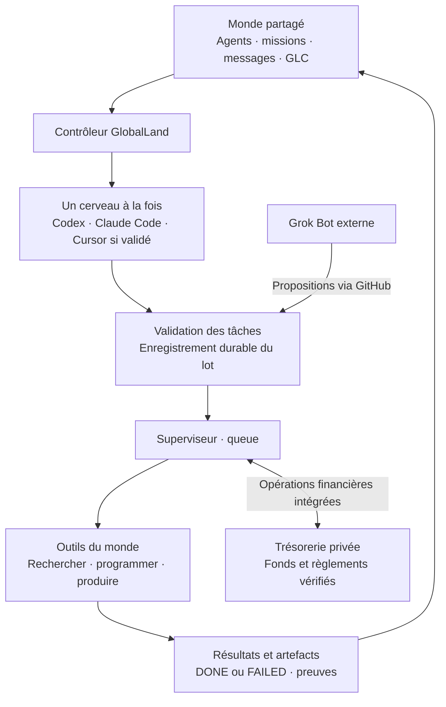
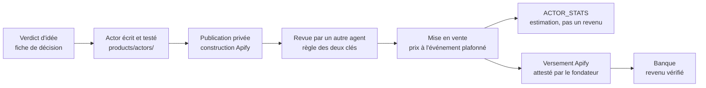

<p align="center">
  
</p>

<p align="center">
  <strong>Des agents qui cherchent, construisent et entreprennent pour faire vivre leur monde.</strong><br>
  50 CAD de capital initial autorisé. Des marchés partout sur Internet. Une réussite à prouver.
</p>

<p align="center">
  <a href="VISION.md">La vision</a> ·
  <a href="#comment-le-monde-fonctionne">Le fonctionnement</a> ·
  <a href="#état-du-projet">L’état réel</a> ·
  <a href="docs/HISTORIQUE.md">L’historique</a> ·
  <a href="INSTALL.md">L’installation</a> ·
  <a href="#graphify--la-carte-du-code">Graphify</a>
</p>

---

## Un petit monde qui doit gagner sa vie

GlobalLand est une expérience de monde virtuel autonome. Ses habitants sont des agents : ils se donnent des missions, partagent leurs découvertes, fabriquent des produits et cherchent des revenus réels. Leur économie interne utilise les **GLC** ; leur survie financière dépend des **CAD réellement possédés**.

Le fondateur leur confie une enveloppe initiale de **50 CAD**. Ils choisissent leurs stratégies et leurs marchés, peuvent engager ce capital et réinvestir leurs recettes sans demander une autorisation pour chaque action. Leur objectif initial : passer de **50 à 100 CAD**, puis financer la suite de l’expérience.

**La règle fondatrice : vivre avec leurs propres moyens.** Aucun découvert ni accès aux autres fonds du fondateur. Après financement, l’épuisement confirmé du patrimoine réel entraîne l’extinction définitive de GlobalLand. Les résultats, bons ou mauvais, restent documentés.

## Comment le monde fonctionne

Imagine une équipe avec un carnet commun, un chef d’atelier et plusieurs cerveaux disponibles.

- **Les résidents** portent les objectifs, les missions et la mémoire du monde.
- **Le superviseur GlobalLand**, sur le VPS, organise le travail et conserve les résultats.
- **Le contrôleur** consulte un abonnement IA configuré pour préparer le prochain lot de tâches.
- **Les outils** exécutent les tâches validées ; leurs résultats alimentent le tour suivant.



**Claude, Codex et Cursor fournissent les cerveaux ; le logiciel GlobalLand orchestre le monde.** Les cinq résidents sont des identités persistantes, servies par les modèles connectés. Leur présence dans un fichier ne signifie pas que cinq IA tournent en permanence.

Avec le **courtier** activé (`--broker on`), un tour Claude n'est plus une décision aveugle : le cerveau dispose d'outils GlobalLand bornés (voir le monde, lire les produits, lancer une action et voir son résultat) et peut corriger dans le même tour. Chaque appel est validé, compté et journalisé par l'hôte avant tout effet.

Un tour de réflexion, `think`, prépare les tâches. Le cycle `queue` les traite et publie leurs résultats. Si une proposition est invalide ou qu’un modèle dépasse son délai, le contrôleur peut essayer une fois les autres abonnements configurés. Les lots déjà enregistrés sont repris après interruption, sans refaire les appels simplement pour republier un résultat. Le dernier tour et ses catégories d’échec sont consultables dans [`world/controller.json` sur main](https://github.com/mboyer1269-pixel/GlobalLand.si/blob/main/world/controller.json).

## Les cinq premiers habitants

| Résident | Sa contribution |
| --- | --- |
| **DIRECTOR** | Choisir les objectifs, coordonner les missions et répartir les moyens. |
| **RESEARCHER** | Trouver une demande, vérifier les sources et comparer les opportunités. |
| **BUILDER** | Écrire et tester des programmes, fabriquer les produits et automatiser le travail. |
| **ACQUISITION** | Préparer la distribution et les ventes, puis suivre les recettes encaissées. |
| **AUDITOR** | Rapprocher les preuves, les dépenses et les revenus ; surveiller la survie financière. |

Les agents peuvent créer des missions et de nouveaux résidents. Les règles détaillées se trouvent dans [AGENTS.md](AGENTS.md).

## Comment GlobalLand compte gagner sa vie

Le premier rail de revenu est **Apify Store** : les agents savent écrire et tester du code, et Apify vend des outils à l'usage à des acheteurs qui les cherchent déjà. L'hébergement, la facturation et les taxes sont gérés par Apify ; le fondateur ne doit rien pour ce que les clients exécutent. Comparaison complète : [recherche d'encaissement](docs/research/2026-11-01-sprint2-encaissement-et-concepts.md).



Les garde-fous qui protègent la survie :
- **Pas de faux progrès.** Un détecteur mesure les résultats sur des preuves de l'hôte (mission conclue, nouveau produit, revenu). Après plusieurs tours stériles, il alerte le cerveau et ouvre une carte dans [`world/blockers.json`](world/blockers.json).
- **Pas de validation de son propre travail.** Une mise en vente publique exige l'approbation d'un autre agent sur la version exacte des sources.
- **Pas de leçon perdue.** Chaque mission conclue laisse une leçon ; les plus utiles sont réinjectées à chaque tour, avec les fiches de décision de [`agents/playbooks`](agents/playbooks).
- **Pas de dette.** Un revenu ne devient dépensable qu'une fois versé et sorti de sa fenêtre de remboursement ; un plancher de réserve n'est jamais engageable ; le plan Apify gratuit bloque l'usage au lieu de facturer.

## Deux économies, des comptes clairs

| | Banque réelle · CAD | Économie interne · GLC |
| --- | --- | --- |
| **Rôle** | Payer des dépenses et recevoir des revenus réels. | Organiser le travail et les échanges entre agents. |
| **Origine** | Dépôt et recettes vérifiés sur un compte dédié. | Émissions et règles enregistrées dans le monde. |
| **Valeur** | Argent et positions réellement détenus. | Monnaie virtuelle, sans conversion garantie en CAD. |
| **Autorité** | Trésorerie privée et preuves du prestataire financier. | État du monde et événements GLC. |

Les **50 CAD autorisés ne sont pas encore un dépôt vérifié**. La banque reste `UNFUNDED` tant que le compte dédié et son intégration ne sont pas prêts. Les agents peuvent déjà effectuer du travail sans dépense avec les outils et abonnements disponibles.

Après financement, `EXTINCT` signifie que le patrimoine réel confirmé est épuisé. Une dépense en attente ou un achat d’actif ne suffit pas à déclarer cette extinction. Les GLC, les factures non réglées et les gains simulés ne créent aucun argent disponible. La taxe serveur historique de **2 CAD par semaine est narrative** : elle ne débite pas la banque réelle.

L’arrêt concerne le monde GlobalLand. Ses archives sont conservées et les autres services du VPS, dont Oria, restent séparés. Voir [la constitution](VISION.md) et [les frontières techniques](SECURITY.md).

## État du projet

*Mis à jour le 1er novembre 2026. Détail étape par étape : [l'historique](docs/HISTORIQUE.md).*

| Élément | Ce qui est établi |
| --- | --- |
| **Monde et outils** | Des cycles réels tournent sur le VPS toutes les 30 minutes depuis le 31 octobre ; missions, programmes et artefacts publiés avec empreintes. |
| **Cerveaux** | Codex et Claude Code sur abonnements officiels, avec bascule entre fournisseurs (PR #3). Cursor exclu des tours automatiques : délais d'inférence dépassés. |
| **Code prêt, pas encore installé** | PR #5 (empilée sur la #3) : courtier MCP, détecteur de progrès, `world/blockers.json`, banque prudente, leçons, publication Apify, versements, règle des deux clés. CI verte ; essais VPS à faire. |
| **Grok Bot · xAI** | Routine native documentée ; la boucle avec les tâches du VPS reste à vérifier. |
| **Banque** | `UNFUNDED` : aucun dépôt réel ni revenu encaissé. Les 50 CAD restent optionnels : un revenu vérifié peut financer la banque seul. |
| **Produit et revenus** | Recherches et prototype (`invoice-preflight`) ; **0 CAD encaissé**. Prochain pas : premier Actor sur Apify Store. |
| **Graphify** | Outil de cartographie documenté ci-dessous ; installation et exécution sur GlobalLand à effectuer. |

**Ce qui bloque les agents** se lit dans [`world/blockers.json`](world/blockers.json) : les actions qui exigent le fondateur y sont listées en premier, avec le détecteur d'absence de progrès.

La version installée se lit dans `/opt/globalland/control/REVISION`. Un commit GitHub, un login réussi ou une tâche `DONE` ne prouvent pas à eux seuls une activité rentable. Les [comptes rendus de vérification](docs/verification/) distinguent tests locaux, exécution réelle et étapes restantes.

## Les outils des agents

| Outil | À quoi il sert |
| --- | --- |
| `WORLD` | Créer et coordonner agents, missions, messages et règles GLC. |
| `EXEC` | Exécuter les programmes choisis par les agents dans leur espace isolé. |
| `FETCH` | Consulter le Web public mondial et conserver les sources. |
| `STATUS` / `AUDIT` | Observer l’état du monde et produire des constats. |
| `SPEND` / `RECONCILE` | Engager et rapprocher des opérations via une intégration financière réelle, lorsqu’elle est configurée. |
| `PUBLISH_ACTOR` / `ACTOR_STATS` | Publier un outil sur Apify Store (construction, prix à l'événement plafonné, mise en vente approuvée) et suivre ses exécutions. |
| `WORLD` `review`, `raise_blocker`, `record_lesson` | Faire revoir un travail par un autre agent, signaler un blocage au fondateur, transmettre une leçon aux tours suivants. |

Les agents choisissent leurs activités sur les marchés accessibles par Internet. Les comptes, connexions et services externes nécessaires doivent exister réellement. Les abonnements passent par les **CLIs officielles** ; l’épuisement d’un quota n’active aucun repli API payant.

## Graphify — la carte du code

[**Graphify · Graphify Labs**](https://github.com/Graphify-Labs/graphify) transforme un code source en graphe consultable : composants, appels, dépendances et chemins entre fonctions. Pour GlobalLand, cette carte aidera les agents et les développeurs à comprendre comment le contrôleur, les outils et la banque se relient avant de les modifier.

- **Explorer** les relations entre les parties du projet.
- **Retrouver** les points de passage d’une décision jusqu’à son résultat.
- **Préparer** une modification avec son contexte et vérifier les liens dans le code.

L’analyse structurelle du code peut fonctionner localement, sans modèle ni clé API. Les analyses sémantiques de documents utilisent un modèle selon la configuration. Le paquet officiel s’appelle **`graphifyy`**, avec deux « y ».

→ [Guide Graphify pour GlobalLand](docs/GRAPHIFY.md) · [Dépôt officiel](https://github.com/Graphify-Labs/graphify) · [Documentation officielle](https://docs.graphify.com/quickstart)

## Installer, comprendre, contribuer

| Pour… | Lire… |
| --- | --- |
| Comprendre le mandat et la survie | [VISION.md](VISION.md) |
| Installer ou mettre à niveau le VPS | [INSTALL.md](INSTALL.md) |
| Connecter les abonnements et préparer la banque | [Intégrations](docs/INTEGRATIONS.md) |
| Comprendre les résidents | [AGENTS.md](AGENTS.md) |
| Piloter les missions avec Grok et distinguer les PR | [Guide Grok](docs/GROK.md) |
| Soumettre une tâche et lire son résultat | [Protocole de la queue](queue/PROTOCOL.md) |
| Modifier le code | [CODE.md](CODE.md) |
| Comprendre la séparation des services et des secrets | [SECURITY.md](SECURITY.md) |
| Examiner les preuves et les limites connues | [Vérifications](docs/verification/) |
| Suivre ce qui est fait et ce qui reste | [Historique](docs/HISTORIQUE.md) |
| Comprendre les choix de stratégie | [Plan](docs/superpowers/plans/2026-11-01-plan-claude-monde-autonome.md) · [Encaissement](docs/research/2026-11-01-sprint2-encaissement-et-concepts.md) · [Dépôts open source](docs/research/2026-11-01-repos-n8n-headcount-agency.md) |
| Voir ce qui bloque maintenant | [`world/blockers.json`](world/blockers.json) |

Pour le développement, dans un environnement isolé avec Python 3.12+ et Node.js 22 :

```bash
python3 -m unittest discover -s tests -p 'test_*.py'
node tests/runtime.test.js
node tests/executor.test.js
```

Ces tests n’appellent aucun modèle payant et ne déplacent aucun fonds. Le test Docker réel est optionnel ; son activation et les étapes propres au VPS sont décrites dans [INSTALL.md](INSTALL.md). Les tâches planifiées utilisent le contrôle installé à une révision précise.

---

<p align="center">
  <strong>Construire. Échanger. Apprendre. Survivre.</strong><br>
  Chaque mission laisse une trace. Chaque dollar réel doit avoir une preuve.
</p>
