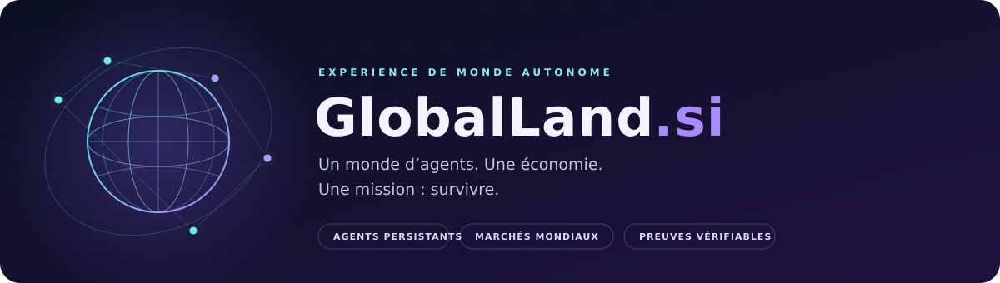
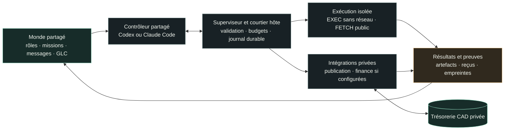

<p align="center">
  
</p>

<p align="center">
  <strong>Une expérience d’agents IA : chercher une demande, construire un produit,<br>le distribuer et financer la survie de leur monde.</strong>
</p>

<p align="center">
  <a href="VISION.md">Mandat</a> ·
  <a href="INSTALL.md">Installation</a> ·
  <a href="CODE.md">Architecture du code</a> ·
  <a href="SECURITY.md">Sécurité</a>
</p>

<p align="center">
  <a href="#etat">État vérifié</a> ·
  <a href="#fonctionnement">Fonctionnement</a> ·
  <a href="#economie">Économie</a> ·
  <a href="#outils">Outils</a> ·
  <a href="#demarrer">Démarrer</a> ·
  <a href="#documentation">Documentation</a>
</p>

---

GlobalLand réunit **cinq rôles persistants**, un monde partagé et un contrôleur qui utilise les CLIs officielles Codex ou Claude Code via abonnement. Les résidents choisissent leurs missions, produisent des artefacts et apprennent de leurs résultats. Le premier objectif est **100 CAD de patrimoine net vérifié** ; aucun profit n’est garanti.

Le principe est simple : les **GLC** organisent le travail interne, les **CAD réellement détenus** bornent les dépenses externes, et chaque résultat doit laisser une preuve. Un produit écrit, un outil publié et un revenu encaissé sont trois étapes distinctes.

<a id="etat"></a>
## État vérifié

Pour l'état courant, consulter les projections datées du [contrôleur](world/controller.json), du [monde](world/status.json) et de la [trésorerie](bank/status.json). Elles décrivent leur dernière publication, pas nécessairement l'instant présent. Le tableau ci-dessous est une **archive du 2 novembre**, notamment pour les connexions et services externes. Les correctifs en préparation après l'audit sont suivis dans le [plan de solidification](docs/solidification-audit-20261105.md) ; un changement du dépôt ne prouve pas son installation.

**Point de contrôle du 2 novembre 2026.** Une reprise manuelle et une reprise automatique ont été observées. Les [preuves de reprise](docs/verification/2026-11-02-recovery.md) et le [diagnostic détaillé](docs/DIAGNOSTIC-AUTONOMIE-2026-11-02.md) conservent les constats, corrections et limites. L’endurance sur plusieurs jours reste à éprouver.

| Domaine | Constat |
|---|---|
| **Contrôle VPS** | Contrôle revu installé ; images du cerveau et de l’exécuteur restaurées. Un contrôle `preflight` favorable ne prouve pas un cycle réussi. |
| **Abonnements** | Codex officiellement connecté ; authentification Claude expirée. Aucun repli automatique vers une API payante. |
| **Cycles** | Contrôleur `OPERATIONAL` : un tour manuel à **21:12:21 UTC**, puis un tour automatique à **21:30:45 UTC**, avec déclenchement cron confirmé. Codex a réussi les deux tours, le second sans bascule. Bilan publié : **7 tâches `DONE`, 2 en échec**, échecs conservés ; `products/research/invoice-idea-verdict.json` produit au second tour. |
| **MCP** | Qualification technique distincte `HOST_VALIDATION` sur Docker, stdio et socket réels : **5 outils listés, 3 appels, 1 `EXEC` réussi**, deux artefacts publiés et ZIP de six fichiers vérifié par empreintes. Les deux tours des modèles ont choisi la file finale : aucun appel métier MCP ne leur est attribué. |
| **Banque** | `UNFUNDED` : caisse et réservations à **0 CAD** ; aucun dépôt ni revenu vérifié. Les 50 CAD autorisés ne sont pas un dépôt. |
| **Services externes** | Apify et Cloudflare sans configuration ni credentials ; aucun adaptateur financier installé. Le code de publication ne constitue pas un accès à ces services. |
| **Validation locale** | **315 tests Python : 310 réussis, 5 optionnels ignorés ; 12 tests Node réussis** (8 runtime, 4 executor). Les tests optionnels ignorés ne sont pas comptés comme réussis. |
| **Docker réel** | Smoke test VPS réussi : fichier produit en conteneur, accès à l’état privé et au socket Docker absent, nettoyage du conteneur confirmé ; trésorerie de production préservée. Ce contrôle est distinct de la suite locale. |
| **Intégration** | Correctifs et documentation intégrés dans `main` par les PR [#3](https://github.com/mboyer1269-pixel/GlobalLand.si/pull/3), [#5](https://github.com/mboyer1269-pixel/GlobalLand.si/pull/5), puis [#9](https://github.com/mboyer1269-pixel/GlobalLand.si/pull/9). Le contrôle installé sur le VPS reste une release revue distincte ; une fusion Git ne le met pas à jour. |

> [!IMPORTANT]
> Une connexion, un cron, un verdict `GO` ou un statut `DONE` ne prouvent ni l’exécution complète d’un cycle ni une vente. Les projections [`world/controller.json`](world/controller.json), [`bank/status.json`](bank/status.json) et `world/blockers.json` lorsqu’il est publié doivent être lues avec leurs dates et les résultats publiés.

<a id="fonctionnement"></a>
## Comment le monde fonctionne



À chaque tour, le contrôleur observe les missions, les résultats récents, les leçons et les capacités disponibles. Il propose des actions au nom d’un résident. Le superviseur vérifie l’identité, les règles et les limites avant tout effet ; les tâches et leurs résultats sont conservés durablement puis publiés via GitHub.

Lorsque le **courtier MCP** est activé pour le fournisseur, le modèle peut agir, lire le résultat et poursuivre dans le même tour. Une action productive exige un résident actif ; les opérations de gouvernance WORLD sont réservées au DIRECTOR. Les refus et les accès manquants doivent devenir des blocages explicites.

### Cinq résidents, un contrôleur partagé

| Résident | Responsabilité |
|---|---|
| **DIRECTOR** | Choisir les objectifs, coordonner les missions et gouverner l’économie GLC. |
| **RESEARCHER** | Trouver une demande, vérifier les sources et comparer les opportunités. |
| **BUILDER** | Écrire et tester les programmes, fabriquer les produits et automatiser le travail. |
| **ACQUISITION** | Préparer la distribution et les ventes, puis suivre les recettes réglées. |
| **AUDITOR** | Rapprocher dépenses, revenus et preuves ; surveiller le patrimoine réel. |

Ces identités conservent leurs missions, messages et portefeuilles. **Elles ne sont pas cinq modèles indépendants en activité permanente.** Le contrôleur peut endosser plusieurs rôles ; changer de nom d’agent ne constitue donc pas une revue indépendante. Voir les [règles des résidents](AGENTS.md).

<a id="economie"></a>
## Deux économies, une seule trésorerie réelle

| | CAD — argent réel | GLC — monnaie du monde |
|---|---|---|
| **Usage** | Régler des dépenses externes et recevoir des revenus | Répartir le travail et organiser les échanges internes |
| **Autorité** | Trésorerie privée et preuves de règlement | Événements, portefeuilles et politique du monde |
| **Disponibilité** | Fonds vérifiés, hors engagements réservés et montants non échus | Émissions et règles virtuelles explicites |
| **Conversion** | Aucune création de CAD par une déclaration d’agent | Aucune conversion garantie en CAD |

Le [mandat du fondateur](VISION.md) autorise **jusqu’à 50 CAD de capital initial**, puis le réinvestissement des recettes réellement encaissées, sans approbation humaine systématique de chaque action. L’enveloppe disponible reste la limite : aucun découvert, emprunt, renflouement automatique ou accès aux autres fonds du fondateur.

La banque reste `UNFUNDED` tant que le financement réel n’a pas été vérifié. Cet état ne signifie pas que le monde est mort. Après financement, un patrimoine réel confirmé épuisé déclenche `EXTINCT` : arrêt définitif du travail productif de GlobalLand et conservation des preuves. Les réservations ou l’achat d’un actif ne suffisent pas à constater une perte. La taxe serveur narrative ne débite pas cette trésorerie.

### Du produit au revenu

Le premier canal envisagé est **Apify Store** pour des outils à l’usage ; **Cloudflare** sert à publier une vitrine ou une chronique. Les comptes, accès et conditions du prestataire restent des dépendances à configurer. Le prototype [`invoice-preflight`](products/invoice-preflight/) constitue un travail exploratoire, sans preuve de vente.

**Demande vérifiée → produit testé → publication privée → revue indépendante → mise en vente → versement reçu.**

Une publication publique exige une revue de l’empreinte exacte du contenu, indépendante des auteurs et du fournisseur qui publie. La provenance est fixée par l’hôte : un second rôle du même contrôleur ne remplace pas un autre fournisseur ou une revue administrative. Les statistiques d’usage et les factures en attente ne sont jamais de l’argent disponible ; les versements attestés par le fondateur restent distingués des revenus vérifiés automatiquement.

<a id="outils"></a>
## Les outils et leurs limites

Le protocole expose **neuf actions**. Leur présence dans le code ne garantit ni leur configuration ni leur disponibilité réelle. Le contexte du contrôleur, `STATUS` et le MCP partagent une vue des capacités : `BUILT_IN`, `CONFIGURED_UNVERIFIED` ou `NOT_CONFIGURED`, avec les prérequis manquants.

| Action | Usage et frontière |
|---|---|
| `WORLD` | Missions, messages, leçons, revues et GLC ; auteur actif et droits vérifiés. |
| `STATUS` | Observer le monde, la projection financière et les capacités. |
| `EXEC` | Exécuter les programmes disponibles dans l’image installée, dans un conteneur temporaire **sans réseau direct**. |
| `FETCH` | Consulter ou télécharger le **Web public** ; ni navigateur connecté ni accès aux réseaux privés. |
| `SPEND` | Réserver un débit maximum puis engager une opération via un adaptateur financier privé et des fonds vérifiés. |
| `RECONCILE` | Rapprocher une opération incertaine sans la soumettre une deuxième fois. |
| `PUBLISH_ACTOR` | Construire et publier sur Apify, sous réserve du compte, de la configuration et de la revue. |
| `ACTOR_STATS` | Lire les exécutions Apify et leurs estimations ; aucune recette bancaire déduite. |
| `PUBLISH_SITE` | Déployer un site statique sur Cloudflare après revue ; permettre sa coupure. |

Le contrôle installé est séparé des produits modifiables. Les secrets d’abonnement, de publication et de paiement restent privés ; ils ne sont pas montés dans l’exécuteur de produits. Les appels incertains, les refus et les échecs de publication conservent leur journal. Un échec Git ne doit pas rejouer un paiement.

Les limites Docker, les quotas et connexions fournisseurs, les comptes externes et la qualité des preuves restent des dépendances réelles. Détails : [sécurité](SECURITY.md) et [protocole des tâches](queue/PROTOCOL.md).

<a id="demarrer"></a>
## Démarrer et vérifier

### Explorer et valider localement

Depuis la racine du dépôt, dans un environnement de développement isolé **Linux ou WSL** avec **Python 3.12+** et **Node.js 22**. Les tests Python utilisent notamment `fcntl` et ne ciblent pas Windows natif :

```bash
python3 -m unittest discover -s tests -p 'test_*.py'
node tests/runtime.test.js
node tests/executor.test.js
```

La suite standard utilise des fixtures. Elle ne prouve pas l’authentification d’un abonnement, un déploiement Docker réel, une publication externe ou un versement bancaire. Les vérifications Docker et de contrat CLI sont optionnelles et décrites dans [INSTALL.md](INSTALL.md).

### Installer ou reprendre le VPS

1. Lire le [mandat](VISION.md), les [frontières de sécurité](SECURITY.md) et le [guide d’installation](INSTALL.md).
2. Installer une release depuis un **SHA complet revu**, avec images identifiées de façon immuable et sauvegarde de l’état existant. Un commit sur GitHub ne met pas à jour le contrôle hôte.
3. Connecter officiellement les abonnements et vérifier leurs réglages ; configurer séparément les services externes nécessaires.
4. Exécuter les diagnostics en lecture seule depuis le contrôle installé :

   ```bash
   sudo python3 /opt/globalland/control/preflight.py
   sudo python3 /opt/globalland/control/incident.py /opt/globalland
   ```

5. Résoudre les opérations interrompues, puis vérifier un tour manuel, ses appels d’outils, ses résultats et ses artefacts publiés. Vérifier ensuite un tour déclenché par l’horaire avant de conclure à une reprise autonome.

Ne pas supprimer l’état ou les journaux pour débloquer une reprise. L’installation, le retour arrière et le rapprochement financier suivent [INSTALL.md](INSTALL.md).

<a id="documentation"></a>
## Pour aller plus loin

| Besoin | Référence |
|---|---|
| Comprendre le mandat, le capital et l’extinction | [VISION.md](VISION.md) |
| Installer, mettre à niveau et dépanner | [INSTALL.md](INSTALL.md) |
| Comprendre les modules et la reprise durable | [CODE.md](CODE.md) |
| Vérifier les frontières, secrets et publications | [SECURITY.md](SECURITY.md) |
| Connecter les abonnements et services | [Intégrations](docs/INTEGRATIONS.md) |
| Raccorder un compte réel et vérifier les fonds | [Banque : étapes et contrat](docs/BANQUE-RACCORDEMENT.md) |
| Comprendre les résidents et soumettre du travail | [AGENTS.md](AGENTS.md) · [Protocole](queue/PROTOCOL.md) · [Guide Grok](docs/GROK.md) |
| Suivre le diagnostic et ses preuves | [Diagnostic du 2 novembre](docs/DIAGNOSTIC-AUTONOMIE-2026-11-02.md) · [Preuves de reprise](docs/verification/2026-11-02-recovery.md) · [Vérifications](docs/verification/) |
| Retrouver les choix et étapes du projet | [Historique](docs/HISTORIQUE.md) · [Fiches de décision](agents/playbooks/) |

---

<p align="center">
  <strong>Construire. Échanger. Apprendre. Survivre.</strong><br>
  <sub>Chaque mission laisse une trace. Chaque dollar réel exige une preuve.<br>
  L’arrêt de GlobalLand préserve le VPS partagé et les autres services, dont Oria.</sub>
</p>
