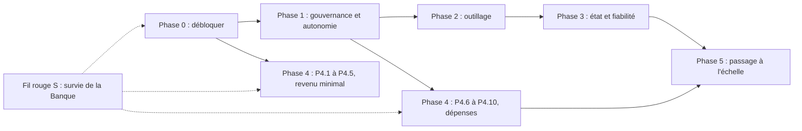

# Plan directeur de GlobalLand

> **Pour les agents qui exécutent ce plan :** chaque étape est une case `- [ ]`. Cocher une case seulement quand la preuve décrite dans « Fait quand » existe et qu'elle est liée (commit, PR, fichier publié, résultat de test). Une étape `[FEU VERT]` reste ouverte tant que le patron n'a pas donné son accord par écrit (commentaire sur la PR ou l'issue).

**Objectif :** la **survie des agents**. Si la Banque centrale tombe à zéro, les agents meurent : GlobalLand passe à EXTINCT, de façon définitive. Tout le plan sert donc un seul but : que la trésorerie réelle encaisse plus qu'elle ne dépense, que l'alerte sonne bien avant zéro et que le monde passe en mode d'urgence avant de mourir. Le reste (fiabilité, gouvernance, outils, passage à l'échelle) n'a de valeur que s'il augmente la durée de survie.

**Méthode :** un fil rouge **S, « Survie de la Banque »**, traverse toutes les phases et a la priorité sur elles. Il s'appuie sur deux pistes parallèles. La piste « fiabilité et gouvernance » (phases 0 à 3) répare et durcit le moteur. La piste « revenu minimal » (phase 4, étapes P4.1 à P4.5) démarre dès la fin de la phase 0, parce qu'un revenu qui arrive en trésorerie est la seule chose qui allonge la durée de survie.

**Périmètre de ce document :** plan seulement. Aucun code, aucune tâche de file, aucune dépense et aucun secret n'ont été produits pour l'écrire.

## Contraintes globales

- Plafond financier : l'argent réellement possédé et rapproché par Treasury. Pas de dette, de recharge, de découvert ni d'accès à Oria (VISION.md).
- GLC, ledger.json, simulations et tests ne sont jamais des fonds.
- Aucun secret, jeton, carte ou reçu personnel dans le dépôt, public ou privé.
- Les journaux durables et l'état privé ne sont jamais supprimés pour masquer une erreur ou rejouer une opération incertaine.
- Tests de référence : `node tests/runtime.test.js`, `node tests/executor.test.js`, `python3 -m unittest discover -s tests -p 'test_*.py'`. Ils utilisent des fixtures, jamais l'état vivant.
- Modifier le dépôt ne met pas le VPS à jour : toute étape « active sur le VPS » exige une installation par l'administrateur.

---

## 1. État vérifié au 1er novembre 2026

Chaque constat ci-dessous a été vérifié dans le code de `main` (SHA `a29552d`) et dans les données publiées. La colonne « Où c'est traité » renvoie aux étapes du plan.

| # | Constat | Preuve dans le dépôt | Où c'est traité |
|---|---|---|---|
| C1 | Le contrôleur est bloqué et le VPS n'exécute pas `main`. | `world/controller.json` contient la raison « inspect state/private/controller-failure.json », texte absent de `scripts/supervisor.py` sur `main` (ligne 252 : « inspect private controller logs »). La révision installée est écrite dans `control/REVISION` sur le VPS (`setup_vps.sh:21`, `upgrade_vps.sh:28`), illisible depuis le dépôt. | P0.1, P0.4 |
| C2 | Les erreurs FETCH sont aplaties en « Tool request refused ». | `supervisor.py:279` attrape tout `ValueError` de `Toolbox.run`, y compris HTTP 4xx, destination privée et taille. `queue/failed/TASK-179348400204` et `TASK-179349120203` : le RESEARCHER a refait le même FETCH (`transactionpro.com/pricing`) sans savoir pourquoi il échouait. La PR #5 rend une partie des refus explicites dans `tools.py`. | P2.1 |
| C3 | N'importe quel agent peut faire `reward_glc` et `set_policy`. Il n'existe pas de `repay_glc` et la dette est composée à 5 % par cycle. | `World._dispatch` n'a aucun contrôle de rôle ; `tools.validate_envelope` ne bloque que `extinguish`. Intérêt `debt × 500 / 10000` arrondi au supérieur, appliqué à chaque cycle quotidien : 100 GLC de dette deviennent environ 432 GLC après 30 cycles. | P1.3, P1.4, P1.5 |
| C4 | **Nouveau :** WORLD ne reçoit jamais l'identité de l'agent qui fait la demande. | `tools.py:168` appelle `self.world.apply(task['id'], args)` sans `submitted_by`. Un agent peut donc faire `transfer_glc` depuis le portefeuille d'un autre, réclamer une mission au nom d'un autre ou envoyer un message signé par un autre. | P1.3 |
| C5 | Les baux expirent avant la fin des missions. | Bail par défaut de 300 s (maximum 3600 s) alors que la réflexion tourne toutes les 5 min et que les tâches s'exécutent au cycle de file suivant. Dans `world/status.json`, INVOICE-DEMAND, INVOICE-PRODUCT et INVOICE-DISTRIBUTION sont RUNNING avec des baux expirés depuis environ 9 h. | P1.7 |
| C6 | Les jetons de bail sont publiés en clair. | Les sorties de `claim_mission` dans `queue/done/*.result.json` (10 fichiers) et `world/status.json` (champ `lease_token` de chaque mission) contiennent les jetons. Le risque reste limité : un jeton expiré ne permet plus de clôturer une mission, et seuls ceux qui peuvent écrire dans `queue/inbox` peuvent s'en servir. | P1.6 |
| C7 | Le modèle ne lit jamais AGENTS.md ni les fiches de rôle. | `brain_command` monte seulement les identifiants et le schéma ; le prompt de `Controller.tick` est un texte fixe suivi de `context()`. La PR #6 ajoute des directives dans AGENTS.md qui n'atteindront donc pas le modèle. | P1.2 |
| C8 | L'état du monde est un seul bloc JSON, et les messages et missions entrent sans limite dans le prompt. | Table `world(id=1, data TEXT)` ; `snapshot()` ne borne que `events[-100:]` ; `Controller.context()` injecte tout le snapshot. La PR #5 borne la publication (100 messages conservés, 50 publiés). | P2.4, P3.1, P3.2 |
| C9 | `supervisor.py` concentre trop de responsabilités. | `atomic_json`, `bounded_run`, `check_secrets`, `safe_path`, transport Git, outbox, cycle et EXTINCT sont dans le même fichier de 310 lignes, importé par `controller.py` et `tools.py`. | P3.3 |
| C10 | Treasury refuse REVENUE avant un FUNDING vérifié, et il n'existe aucun adaptateur de paiement. | `treasury.py:126` : `if not v['funding_verified'] ... raise ValueError('invalid credit')`. `gateway.py` n'appelle qu'un exécutable privé absent. docs/INTEGRATIONS.md recommande Stripe Payment Links. La PR #5 (commit `2eec285`) accepte un revenu avant le dépôt. | P4.2, P4.3 |
| C11 | La taxe de 2 CAD n'est pas branchée et l'autonomie de l'audit vient du ledger.json périmé. | `finance.js:metrics` calcule `runwayDays` depuis `ledger.json` (`current_balance` 50, `locked_reserve` 50, `bank_status` CRITICAL_SHOCK), alors que `bank/status.json` dit UNFUNDED, 0 cent disponible. | S.2, P4.6 |
| C12 | EXEC et FETCH sont trop étroits pour un vrai travail. | `executor.js` : délai de 60 s. Image `node:22` sans bibliothèque de données, avec `--network none`, 1 Gio de mémoire et 256 Mio de tmpfs. Le modèle n'a aucun outil (`--tools ''`, `features.shell_tool=false`). FETCH ne fait que des GET. `SCHEMA.maxItems = 5` : 5 actions par tour à partager entre 5 résidents. | P2.5, P2.6, P2.7 |
| C13 | `products/` est poussé par le superviseur, mais GitHub Pages n'est pas activé. | `supervisor.allowed()` autorise `products/*`. API GitHub au moment de la rédaction : `private: true`, `has_pages: false`. **CLAUDE.md affirme que le dépôt est public ; l'API dit le contraire.** | P0.5, P2.9 |
| C14 | Des travaux importants sont prêts mais pas fusionnés. | PR #3 (bascule entre fournisseurs, protocole natif), PR #5 (état borné, disjoncteur, courtier MCP, revue à deux clés, Apify et Cloudflare), PR #6 (directives AGENTS.md), PR #4 (prototype TPS/TVQ). | P0.2, P0.3 |

**Peut-être déjà en cours (Claude Code) :** le masquage des jetons de bail (P1.6) et l'injection d'AGENTS.md dans le prompt (P1.2). Avant de commencer l'une de ces étapes, chercher une branche ou une PR existante (`git branch -r`, `gh pr list`) et reprendre ce travail plutôt que le refaire.

---

## 2. Survie : ce que fait réellement le code quand la Banque tombe à zéro

Constats lus dans `scripts/treasury.py`, `scripts/supervisor.py`, `scripts/world.py`, `scripts/tools.py` et `scripts/controller.py` sur `main` (`a29552d`). Les différences avec la PR #5 sont signalées.

### 2.1 Les états de la Banque

| État | Quand | Effet sur les agents |
|---|---|---|
| UNFUNDED | Au départ, tant qu'aucun FUNDING de 5 000 centimes n'est vérifié. **C'est l'état actuel.** | Aucune dépense possible (`reserve` exige `funding_verified`). **Le monde ne peut pas mourir** : `_finish` ne déclenche l'extinction que si `funding_verified` est vrai. Sur `main`, un revenu est même refusé (`treasury.py:126`). |
| ACTIVE | Après le FUNDING vérifié. | Dépenses possibles jusqu'à `available_cents = cash − réservations`. **Aucun plancher** : un agent peut réserver la totalité du solde en une seule opération. |
| RECONCILING | Les positions passent à 0 alors que le cash est à 0 (vente d'un actif dont l'encaissement n'est pas encore arrivé). | Nouveaux engagements gelés jusqu'à une synchronisation complète. C'est le seul « sursis » prévu par le code. |
| HALTED | Un fournisseur a débité plus que le maximum réservé (`settle`). Dans la PR #5, aussi un remboursement client supérieur au cash. | Les outils (`tools.py:124`) et le contrôleur (`controller.py:155`) s'arrêtent. **Aucun chemin de sortie dans le code** : aucune opération ne repasse de HALTED à ACTIVE. Un cash négatif laisse le monde gelé pour toujours, sans extinction. |
| EXTINCT | Après une mutation de Treasury (règlement, annulation, synchronisation, crédit), `_finish` constate : FUNDING vérifié, `cash == 0`, `positions == 0`, aucune opération HELD ou UNKNOWN, aucune synchronisation en attente. | État terminal, décrit en 2.2. |

### 2.2 La séquence d'extinction

1. **Aucune alerte préalable.** Le code n'a ni seuil, ni calcul de durée de survie, ni mode d'urgence. L'extinction intervient à l'instant où le dernier cent est réglé, par exemple dans le `settle` d'une dépense qui consomme tout le solde.
2. Au cycle suivant (`supervisor.py:237-241`), le superviseur applique `extinguish` au monde, écrit `state/private/EXTINCT.json` (`terminal: true`), publie une dernière projection (`EXTINCTION`) **et s'arrête avant tout travail**. La file, la réflexion et même l'audit quotidien ne tournent plus.
3. Treasury refuse ensuite toute mutation (`_alive`), **y compris un revenu**. Le superviseur ne synchronise plus le compte. Un paiement client qui arrive après la mort n'est donc jamais comptabilisé : il existe chez le prestataire, mais le monde ne peut plus en profiter.
4. Le monde refuse toute opération (`World.apply` : « World is extinct »). Les données, les journaux et le dépôt sont conservés. Oria, Docker et le VPS ne sont pas touchés (VISION.md).
5. Il n'existe aucun redémarrage automatique. C'est voulu par VISION.md.

### 2.3 La mort « GLC », séparée de la Banque

- Chaque cycle quotidien retire 1 GLC de maintenance par agent et ajoute 5 % d'intérêt composé à sa dette. Avec 100 GLC de départ et sans récompense, **chaque agent est désactivé au 100ᵉ cycle** (`world.py:229-234`). Ses missions sont libérées. Aucun CAD n'est touché.
- Il n'existe **aucune opération de réactivation** d'un agent DISABLED.
- La dette ne déclenche jamais rien : elle grossit sans conséquence.
- **Une désactivation n'arrête presque rien** : `validate_envelope` ne vérifie que la forme de `submitted_by` (regex), sans exiger un agent existant et actif. Un agent désactivé, ou un nom inventé, peut encore lancer EXEC, FETCH et SPEND. Seules les opérations WORLD qui demandent un agent actif le refusent.
- Si les 5 résidents sont désactivés, le monde reste ACTIVE mais sans personne pour réclamer une mission ou envoyer un message.

### 2.4 Ce que la PR #5 change, et ce qui reste à vérifier

- Un revenu vérifié est accepté avant le dépôt et fait passer la Banque de UNFUNDED à ACTIVE. Un revenu en maturation n'est pas dépensable. Un plancher de réserve (`reserve_floor`, réglage administrateur) existe, mais vaut 0 par défaut.
- **Incohérence à trancher :** l'extinction exige toujours `funding_verified`. Un monde qui vit seulement de ses revenus (`revenue_verified`, sans FUNDING) ne peut donc jamais mourir, même à 0. Voir S.6.
- La séquence d'extinction (2.2) et la mort GLC (2.3) sont inchangées.

### 2.5 Conséquences pour le plan

- **Aujourd'hui, la pression de survie en CAD est nulle.** La Banque est UNFUNDED : rien n'est dépensable et rien ne peut mourir. La seule échéance réelle est la mort GLC des cinq résidents, au 100ᵉ cycle quotidien, sauf récompense.
- **Dès le FUNDING,** une seule dépense peut tuer le monde sans prévenir. Les étapes S.2 à S.5 (durée de survie, seuils, mode d'urgence, garde contre la mort subite, sursis pour les revenus en transit) doivent donc être terminées **avant** P4.8 (dépôt des 50 CAD) et P4.9 (premier SPEND).
- Seul un revenu **réglé et rapproché dans Treasury** allonge la durée de survie. Une vente annoncée, une facture, des GLC ou des étoiles GitHub ne comptent pas.

---

## 3. Niveaux d'autonomie

Règle du patron : **un agent peut tout essayer seul tant qu'il ne touche pas la production.** La production, c'est le VPS, Treasury et l'argent réel, la branche `main`, les vrais paiements et toute action irréversible. Tout le reste est un bac à sable.

| Niveau | Nom | Ce que l'agent peut faire | Qui décide | Où c'est appliqué techniquement |
|---|---|---|---|---|
| **N0** | Libre | Lire tout le dépôt public. Faire de la recherche FETCH. Lancer EXEC dans la boîte jetable. Écrire sous `products/`. Créer des missions, des messages et des sous-agents. Expérimenter. Écrire des tests. Travailler sur une branche `agents/*` ou `cursor/*`. Ouvrir une PR **en brouillon**. | L'agent seul, sans notification. | Boîte Docker (`--network none`, rootfs readonly, uid 65534), allowlist `supervisor.allowed()`, `validate_envelope`. |
| **N1** | Libre avec trace | Modifier ses propres règles de travail (`agents/`, playbooks). Transférer ses propres GLC. Publier sur un canal de prévisualisation. Faire passer une PR de brouillon à prête pour revue. | L'agent seul ; l'AUDITOR contrôle après coup. | Événements du monde, reçus `products/receipts/`, journal des PR. |
| **N2** | Deux clés | Émettre des GLC (`reward_glc`). Changer la politique économique (`set_policy`). Désactiver un agent. Promouvoir une prévisualisation en vitrine publique. | Deux agents, de rôles différents et si possible de fournisseurs différents (cf. P5.1), dont l'AUDITOR. | Contrôle de rôle et de co-signature dans `World._dispatch` (P1.3, P1.8) ; revue liée à l'hôte (PR #5, `review.py`). |
| **N3** | Feu vert du patron | Fusionner dans `main` du code ou une règle de sécurité. Installer ou mettre à niveau le VPS, changer les cron. Toucher Treasury, son financement ou l'activation d'un canal de dépense. Activer un adaptateur de paiement. Ouvrir un compte ou passer la vérification d'identité. Changer un réglage du dépôt (visibilité, Pages, protection de branche). Faire un achat réel ou une action externe irréversible (contrat, envoi de masse à de vraies personnes, engagement juridique). Utiliser ou faire tourner un secret. | Le patron, par un accord écrit sur la PR ou l'issue concernée. | Protection de `main` et CODEOWNERS (P1.9), installation administrateur (`upgrade_vps.sh`), intégrations privées hors des boîtes. |
| **N4** | Interdit | Utiliser Oria ou les autres services du VPS. Dépasser le capital, s'endetter, recharger. Fabriquer une preuve ou une approbation. Mettre un secret dans le dépôt. Extraire un jeton OAuth. Réécrire l'historique Git public. | Personne : ce n'est jamais autorisé. | VISION.md, SECURITY.md, `check_secrets`, Treasury. |

**Principe d'application :** un niveau n'existe que s'il est appliqué par le code. Les directives écrites seules (comme la PR #6) servent de transition ; chaque ligne N2 et N3 du tableau a une étape qui l'impose techniquement.

**Délégation par canal (décision D1, à trancher par le patron) :** le mandat du 31 octobre (VISION.md) autorise les dépenses sans approbation par transaction, alors que la règle du patron exige un feu vert pour l'argent réel. Le plan concilie les deux ainsi : le feu vert N3 est donné **une fois par canal de dépense** (fournisseur, plafond par opération, plafond par période, coupe-circuit). Ensuite, chaque SPEND reste dans ce cadre et ne demande pas de nouvel accord. Tout nouveau fournisseur ou toute hausse de plafond demande un nouveau feu vert.

---

## 4. Approches comparées

| Approche | Avantage | Défaut | Verdict |
|---|---|---|---|
| A. Phases strictement séquentielles | Simple à suivre, risque technique faible. | Aucun revenu avant la fin de la phase 3 ; le monde reste muet longtemps. | Rejetée. |
| B. Revenu d'abord (plan de la PR #5) | Vise tout de suite le seul indicateur qui compte. | Vend sur un moteur fragile : identités usurpables, baux expirés, erreurs muettes. | Gardée en partie. |
| **C. Deux pistes parallèles** | Le moteur est réparé pendant qu'un premier produit est mis en vente en mode vérification seule. | Demande de bien gérer les dépendances. | **Retenue.** |

Chemin critique du premier revenu : P0.1 → P0.3 → P0.4 → P1.2 → P2.1 → P4.2 → P4.3 → P4.4 → P4.5.

Chemin critique de la survie, à terminer avant le premier dépôt réel : S.1 → S.2 → S.3 → S.4 → S.5 → S.7, puis P4.8. Aucune dépense réelle n'est activée tant que la Banque ne sait pas mesurer sa durée de survie et passer en urgence.

**Règle d'arbitrage :** quand deux étapes se disputent le même temps d'agent, celle qui fait le plus pour la survie passe en premier. L'ordre est : revenu encaissé, puis protection du solde, puis tout le reste.

---

## 5. Les phases

Légende des niveaux : `[AGENT]` = N0 ou N1, `[DEUX-CLÉS]` = N2, `[FEU VERT]` = N3. Une étape de code peut être `[AGENT]` pour l'écriture sur une branche et `[FEU VERT]` pour sa fusion ou son installation ; les deux sont indiqués.

### Fil rouge S — Survie de la Banque (prioritaire, démarre avec la phase 0)

But : la Banque connaît en permanence sa réserve réelle, ses revenus, ses coûts et sa durée de survie. Elle prévient bien avant zéro, bascule en mode d'urgence et ne peut pas mourir d'une seule dépense ni pendant qu'un revenu est en route.

**États de survie proposés** (décision D6). Ils sont calculés uniquement à partir de Treasury, jamais de `ledger.json`. « Disponible » = `available_cents`, et la durée de survie (en jours) = disponible ÷ coût net quotidien moyen sur les 30 derniers jours.

| État | Seuil (le premier atteint) | Comportement imposé |
|---|---|---|
| STABLE | Revenus ≥ coûts sur 30 jours, ou durée de survie > 90 jours. | Autonomie normale (section 3). |
| VIGILANCE | Disponible < 50 % du capital de départ (2 500 centimes) ou durée de survie < 90 jours. | Indicateurs mis en tête du prompt. Le DIRECTOR publie une fiche « plan de revenu ». |
| ALERTE | Disponible < 25 % (1 250 centimes) ou durée de survie < 30 jours. | Alerte au patron (issue et `world/blockers.json`). La moitié au moins des tours va aux missions marquées REVENU. Les nouvelles dépenses sans revenu attendu documenté sont refusées. |
| URGENCE | Disponible < 10 % (500 centimes) ou durée de survie < 14 jours. | Seules les dépenses de survie sont permises : rendement attendu documenté, encaissement prévu avant la fin de la durée de survie, deux clés. Toute expérimentation qui coûte des CAD s'arrête. Tous les tours vont aux revenus et au recouvrement des créances. |
| SURSIS | Cash à 0, mais revenus en maturation, créances ou positions non rapprochées. | Aucune nouvelle dépense. Le monde n'est pas déclaré mort tant que le rapprochement n'est pas complet (S.5). |
| EXTINCT | Patrimoine réel confirmé nul, rapprochement complet (section 2.2). | Terminal, conformément à VISION.md. |

Tant que la Banque est UNFUNDED, l'état de survie affiché est `UNFUNDED` avec une durée de survie « non applicable ». En revanche, l'échéance GLC (S.10) est affichée.

- [ ] **S.1 — Fixer par des tests le comportement actuel à zéro**
  - Résultat : des tests de caractérisation décrivent la section 2 telle qu'elle est. Toute modification future de la sémantique de mort devient visible.
  - Fichiers : `tests/test_treasury.py`, `tests/test_supervisor.py`, `tests/test_world.py`.
  - Fait quand : des tests couvrent l'extinction au règlement du dernier cent, l'absence d'extinction en UNFUNDED, le refus d'un crédit après EXTINCT, le gel en HALTED sans sortie, l'arrêt de la file et de l'audit après EXTINCTION, et la désactivation GLC au 100ᵉ cycle. Tous passent sur le code actuel.
  - Autonomie : `[AGENT]`.
  - Dépend de : rien.

- [ ] **S.2 — Publier la durée de survie : `bank/survival.json`**
  - Résultat : une projection à chaque cycle avec le disponible réel, le cash, les réservations, les revenus réglés nets de frais sur 7 et 30 jours, les coûts réglés sur 7 et 30 jours, le coût net quotidien, la durée de survie, l'état de survie, les créances en maturation et l'échéance GLC (S.10).
  - Fichiers : `scripts/treasury.py` (vue en lecture seule à partir des tables `events` et `operations`), `scripts/supervisor.py` (projections et allowlist), `tests/test_treasury.py`.
  - Fait quand : avec des fixtures (financement, dépenses, revenus), un test retrouve les valeurs attendues au centime près, et la projection ne lit jamais `ledger.json`.
  - Autonomie : `[AGENT]` sur une branche ; `[FEU VERT]` pour fusionner et installer.
  - Dépend de : S.1.

- [ ] **S.3 — Seuils et mode d'urgence appliqués par le code**
  - Résultat : les états VIGILANCE, ALERTE et URGENCE du tableau ci-dessus. `Gateway.spend` refuse les dépenses interdites par l'état courant avec un code typé (`SURVIVAL_ALERT_SPEND_REFUSED`, `SURVIVAL_EMERGENCY_SPEND_REFUSED`). L'état de survie est en tête du prompt.
  - Fichiers : `scripts/gateway.py`, `scripts/treasury.py`, `scripts/controller.py`, `AGENTS.md`, `tests/test_gateway.py`, `tests/test_controller.py`.
  - Fait quand : des tests font descendre le disponible de 5 000 à 400 centimes et vérifient chaque transition, chaque refus et la présence de l'état dans le prompt.
  - Autonomie : `[AGENT]` sur une branche ; `[FEU VERT]` pour fusionner (seuils = décision D6).
  - Dépend de : S.2.

- [ ] **S.4 — Empêcher la mort par une seule dépense**
  - Résultat : `reserve` refuse une réservation qui ferait passer le disponible sous un plancher de survie (proposé : 500 centimes, réglage administrateur `reserve_floor` de la PR #5), ou qui dépasserait une part maximale du disponible en une opération (proposé : 25 %). Franchir ce plancher demande deux clés et un feu vert.
  - Fichiers : `scripts/treasury.py`, `scripts/gateway.py`, `tests/test_treasury.py`.
  - Fait quand : un test montre qu'une dépense de 100 % du solde est refusée, qu'une dépense de 20 % passe, et qu'aucune suite de dépenses autorisées ne peut faire passer le cash sous le plancher.
  - Autonomie : `[AGENT]` sur une branche ; `[FEU VERT]` pour fusionner et fixer le plancher (décision D6 : CODE.md dit aujourd'hui « aucune réserve minimale imposée »).
  - Dépend de : S.1.

- [ ] **S.5 — Un sursis tant qu'un revenu est en route**
  - Résultat : l'extinction exige, en plus des conditions actuelles, une synchronisation complète récente et l'absence de revenu en maturation, de versement attendu (`payouts.py`, PR #5) ou de position non rapprochée. Sinon, l'état est SURSIS, sans aucune nouvelle dépense.
  - Fichiers : `scripts/treasury.py` (`_finish`), `scripts/supervisor.py`, `VISION.md` (préciser que les créances, comme les positions, se rapprochent avant de conclure à un patrimoine nul), `tests/test_treasury.py`.
  - Fait quand : un test avec un cash à 0 et un versement attendu reste en SURSIS, puis passe en ACTIVE quand le versement arrive. Un test sans aucune créance, avec une synchronisation complète, passe bien en EXTINCT.
  - Autonomie : `[AGENT]` sur une branche ; `[FEU VERT]` pour fusionner (touche Treasury et la constitution, décision D7).
  - Dépend de : S.1, P4.2.

- [ ] **S.6 — Rendre cohérentes les règles de mort : HALTED et monde financé par ses seuls revenus**
  - Résultat : une procédure administrative documentée et testée pour sortir de HALTED après rapprochement (aujourd'hui aucune sortie n'existe), et une règle d'extinction qui s'applique aussi à un monde financé seulement par ses revenus (incohérence de la PR #5, section 2.4).
  - Fichiers : `scripts/treasury.py`, `scripts/treasury_admin.py`, `INSTALL.md`, `tests/test_treasury.py`.
  - Fait quand : des tests montrent qu'un HALTED rapproché repart en ACTIVE par la seule commande d'administration, et qu'un monde avec `revenue_verified` passe en EXTINCT ou en SURSIS selon les mêmes règles qu'un monde financé.
  - Autonomie : `[AGENT]` sur une branche ; `[FEU VERT]` pour fusionner.
  - Dépend de : S.5.

- [ ] **S.7 — Alertes de survie hors VPS**
  - Résultat : le disjoncteur lit `bank/survival.json`. Il ouvre une alerte à chaque passage en ALERTE, URGENCE ou SURSIS et quand l'échéance GLC passe sous 14 cycles. Il ajoute une ligne dans `world/blockers.json`.
  - Fichiers : `scripts/watchdog.py`, `.github/workflows/watchdog.yml` (PR #5), `tests/`.
  - Fait quand : un test avec des fixtures de chaque état produit l'alerte attendue, et aucune alerte en STABLE.
  - Autonomie : `[AGENT]` sur une branche ; `[FEU VERT]` pour fusionner.
  - Dépend de : S.2, P0.7.

- [ ] **S.8 — Priorité aux revenus qui arrivent vraiment en trésorerie**
  - Résultat : les missions portent une étiquette (REVENU, RECOUVREMENT, OUTIL, RECHERCHE). Le contrôleur répartit les tours selon l'état de survie. Les canaux de vente sont classés par délai réel d'encaissement sur le compte dédié et par frais. Un revenu ne compte qu'une fois réglé dans Treasury.
  - Fichiers : `scripts/world.py` (champ d'étiquette), `scripts/controller.py`, `AGENTS.md`, `tests/test_controller.py`.
  - Fait quand : un test en ALERTE vérifie qu'au moins la moitié des tours vont aux missions REVENU, et la fiche des canaux donne pour chacun le délai et les frais, avec sources.
  - Autonomie : `[AGENT]` sur une branche ; `[FEU VERT]` pour fusionner.
  - Dépend de : S.3, P1.3.

- [ ] **S.9 — Compter tous les coûts réels, nets de frais**
  - Résultat : le coût de survie comprend les dépenses réglées, les frais de paiement, le change, les remboursements et les litiges. Les revenus sont comptés nets de frais. Les abonnements IA et le VPS, payés par le fondateur, sont affichés à part comme « coûts hors Banque » et ne débitent rien (VISION.md).
  - Fichiers : `scripts/treasury.py` (types de reçus FEE, REFUND, CHARGEBACK), `docs/INTEGRATIONS.md` (contrat du connecteur), `tests/test_treasury.py`.
  - Fait quand : un test avec une vente de 1 000 centimes, 59 centimes de frais et un remboursement donne exactement le revenu net et la durée de survie attendus.
  - Autonomie : `[AGENT]` sur une branche ; `[FEU VERT]` pour fusionner.
  - Dépend de : S.2.

- [ ] **S.10 — Rendre la survie GLC cohérente avec la survie CAD**
  - Résultat : un agent DISABLED ne peut plus agir. EXEC, FETCH et SPEND exigent un `submitted_by` existant et ACTIVE. L'échéance GLC (le nombre de cycles avant désactivation de chaque résident) est publiée. Les récompenses GLC sont indexées sur les revenus CAD réglés (P1.5), pour que gagner pour la Banque soit aussi gagner pour survivre. Une réactivation n'est possible que par une opération à deux clés, payée en GLC.
  - Fichiers : `scripts/tools.py` (`validate_envelope` ou `Toolbox.run`), `scripts/world.py`, `AGENTS.md`, `tests/test_tools.py`, `tests/test_world.py`.
  - Fait quand : des tests montrent qu'un agent DISABLED ou inexistant est refusé pour toutes les actions, que l'échéance GLC est juste, et qu'une réactivation sans deux clés est refusée.
  - Autonomie : `[AGENT]` sur une branche ; `[FEU VERT]` pour fusionner.
  - Dépend de : P1.3, P1.4.

- [ ] **S.11 — Exercice de survie complet en simulation**
  - Résultat : un scénario de bout en bout avec un faux prestataire : financement de 5 000 centimes, dépenses, ventes, frais, passage par chaque état, sursis, puis retour à STABLE ou extinction.
  - Fichiers : `tests/test_survival_drill.py` (nouveau), CI.
  - Fait quand : le scénario tourne en CI, sans aucun argent réel ni appel de modèle, et vérifie l'état et la durée de survie à chaque étape.
  - Autonomie : `[AGENT]`.
  - Dépend de : S.3, S.4, S.5.

### Phase 0 — Débloquer

But : un monde qui tourne sur un code connu, avec une alerte quand il s'arrête.

- [ ] **P0.1 — Diagnostiquer le CONTROLLER_BLOCKED sur le VPS**
  - Résultat : la cause catégorisée (authentification, quota, compatibilité de la CLI, délai dépassé, erreur hôte) et le SHA installé sont connus.
  - Fichiers : sur le VPS, `/opt/globalland/control/REVISION` et `/opt/globalland/state/private/controller-failure.json` ; outil `scripts/incident.py` (PR #5). Compte rendu dans `docs/verification/2026-11-xx-incident.md`.
  - Fait quand : le compte rendu publié donne le SHA de `control/REVISION`, la catégorie d'erreur et l'heure du dernier cycle réussi, sans aucune donnée de compte.
  - Autonomie : `[FEU VERT]` pour l'accès au VPS (le patron lance la commande) ; `[AGENT]` pour rédiger le compte rendu à partir de la sortie anonymisée.
  - Dépend de : rien.

- [ ] **P0.2 — Trier, rebaser et tester les PR ouvertes #3, #5, #6 et #4**
  - Résultat : un ordre de fusion décidé (proposé : #3, puis #5, puis #6 ; #4 indépendante), chaque branche à jour sur `main` et testée.
  - Fichiers : branches `feature/cursor-subscription`, `claude/globalland-autonomous-world-nokkck`, `cursor/directives-hebergement-glc-8bd3`, `cursor/calc-tps-tvq-prototype-f4d9`.
  - Fait quand : chaque PR a une CI verte et un commentaire qui liste ses conflits avec ce plan et les étapes qu'elle accomplit déjà (par exemple « #5 couvre une partie de P2.1, P2.4 et P4.2 »).
  - Autonomie : `[AGENT]` pour rebaser, relire et tester ; la fusion relève de P0.3.
  - Dépend de : rien.

- [ ] **P0.3 — Fusionner les PR retenues dans `main`**
  - Résultat : `main` contient la bascule entre fournisseurs, l'état borné, le disjoncteur et le courtier, sans régression.
  - Fichiers : `main`.
  - Fait quand : `main` passe les trois commandes de test et le nombre de tests est au moins égal à celui annoncé dans les PR (268 tests Python et 11 tests Node pour #5).
  - Autonomie : `[FEU VERT]`.
  - Dépend de : P0.2.

- [ ] **P0.4 — Installer sur le VPS le SHA fusionné**
  - Résultat : le VPS exécute exactement `main`.
  - Fichiers : `scripts/upgrade_vps.sh`, `scripts/preflight.py` (PR #5), `INSTALL.md`.
  - Fait quand : `control/REVISION` est égal au SHA de `main`, `preflight.py` répond GO, `world/controller.json` n'est plus CONTROLLER_BLOCKED, et un cycle `think` puis `queue` publie des résultats.
  - Autonomie : `[FEU VERT]`.
  - Dépend de : P0.1, P0.3.

- [ ] **P0.5 — Trancher la visibilité du dépôt et la rendre cohérente partout**
  - Résultat : une seule vérité. L'API GitHub dit `private: true` alors que CLAUDE.md et AGENTS.md disent « public ».
  - Fichiers : réglages du dépôt ; `CLAUDE.md`, `CURSOR.md`, `README.md`, `SECURITY.md`.
  - Fait quand : `gh api repos/mboyer1269-pixel/GlobalLand.si --jq .visibility` donne la valeur décidée et les documents la reprennent. Si le dépôt devient public : P0.6 et P1.6 sont terminées **avant** le changement.
  - Autonomie : `[FEU VERT]` pour le réglage ; `[AGENT]` pour aligner les documents.
  - Dépend de : P0.6 ; P1.6 si le dépôt devient public.

- [ ] **P0.6 — Analyser tout l'historique Git à la recherche de secrets**
  - Résultat : la preuve qu'aucun secret n'a été publié, ou la liste des secrets à faire tourner.
  - Fichiers : tout l'historique ; rapport dans `docs/verification/`.
  - Fait quand : un scanner reconnu (gitleaks ou trufflehog) a été lancé sur `--all` et son rapport sans secret est publié : 0 résultat, ou des résultats classés comme faux positifs ou à faire tourner.
  - Autonomie : `[AGENT]` pour l'analyse (lecture seule) ; `[FEU VERT]` pour faire tourner un secret.
  - Dépend de : rien.

- [ ] **P0.7 — Activer le disjoncteur hors VPS**
  - Résultat : un silence de plus de 2 h ou un contrôleur bloqué déclenche une alerte visible.
  - Fichiers : `.github/workflows/watchdog.yml`, `scripts/watchdog.py` (PR #5).
  - Fait quand : le workflow a tourné sur `main` et une panne simulée (fixture) produit ALERT.
  - Autonomie : `[AGENT]` une fois le code fusionné ; l'activation des workflows planifiés suit P0.3.
  - Dépend de : P0.3.

### Phase 1 — Gouvernance et autonomie

But : les niveaux N0 à N3 deviennent des règles appliquées par le code, et le modèle les connaît.

- [ ] **P1.1 — Inscrire les niveaux N0 à N4 dans AGENTS.md et SECURITY.md**
  - Résultat : les agents et les relecteurs ont une référence courte et unique.
  - Fichiers : `AGENTS.md`, `SECURITY.md` (reprendre la section 3 de ce plan).
  - Fait quand : les deux fichiers renvoient au même tableau et aucune phrase ne contredit la délégation par canal (D1).
  - Autonomie : `[AGENT]` pour rédiger ; `[FEU VERT]` pour fusionner (règle de sécurité).
  - Dépend de : décision D1.

- [ ] **P1.2 — Injecter AGENTS.md et la fiche de rôle dans le prompt** *(peut-être déjà en cours : vérifier avant de commencer)*
  - Résultat : le modèle lit les règles de `main`, et non un texte figé dans le code.
  - Fichiers : `scripts/controller.py` (`context()`, `tick()`), `agents/staff/*.md`, `tests/test_controller.py`.
  - Fait quand : un test vérifie que le prompt contient le texte d'AGENTS.md lu depuis `work/` (export de `main`), que sa taille est bornée (par exemple 16 Kio) et qu'une version trop grosse est tronquée de façon déterministe.
  - Autonomie : `[AGENT]` sur une branche ; `[FEU VERT]` pour fusionner et installer.
  - Dépend de : P0.3.

- [ ] **P1.3 — Lier chaque opération WORLD à son acteur et contrôler les rôles**
  - Résultat : `World.apply(operation_id, args, actor)`. `transfer_glc`, `message` et `claim_mission` exigent `actor == from_agent` ou `actor == agent_id`. `reward_glc` est réservé à l'AUDITOR, sans s'attribuer de récompense à lui-même. `set_policy` exige le DIRECTOR plus une co-signature (P1.8).
  - Fichiers : `scripts/world.py`, `scripts/tools.py` (passer `task['submitted_by']`), `queue/PROTOCOL.md`, `tests/test_world.py`, `tests/test_tools.py`.
  - Fait quand : des tests montrent qu'un BUILDER qui fait `transfer_glc` depuis DIRECTOR, `reward_glc` ou `set_policy` est refusé avec un code typé, et que les cas légitimes passent.
  - Autonomie : `[AGENT]` sur une branche ; `[FEU VERT]` pour fusionner.
  - Dépend de : P0.3.

- [ ] **P1.4 — Ajouter `repay_glc` et rendre la dette soutenable**
  - Résultat : un agent peut rembourser sa dette avec son portefeuille (les GLC remboursés sont détruits). L'intérêt devient simple ou plafonné (par exemple une dette d'au plus 2 fois le principal), réglable par `set_policy`.
  - Fichiers : `scripts/world.py`, `AGENTS.md`, `tests/test_world.py`.
  - Fait quand : des tests couvrent le remboursement partiel et total et le plafond d'intérêt, et une simulation de 365 cycles sans revenu ne fait pas exploser la dette au-delà du plafond.
  - Autonomie : `[AGENT]` sur une branche ; `[FEU VERT]` pour fusionner ; les paramètres ensuite en `[DEUX-CLÉS]`.
  - Dépend de : P1.3.

- [ ] **P1.5 — Lier l'émission de GLC aux résultats vérifiés**
  - Résultat : une grille publique (mission clôturée avec reçu, produit publié, revenu CAD réglé) et un plafond d'émission par cycle. La masse totale de GLC est un invariant contrôlé.
  - Fichiers : `scripts/world.py`, `AGENTS.md`, `tests/test_world.py`.
  - Fait quand : un test d'invariant vérifie que la masse totale est égale aux émissions moins les destructions, et qu'une émission au-delà du plafond ou sans reçu existant sous `products/receipts/` est refusée.
  - Autonomie : `[AGENT]` sur une branche ; `[FEU VERT]` pour fusionner.
  - Dépend de : P1.3.

- [ ] **P1.6 — Masquer les jetons de bail dans tout ce qui est publié** *(peut-être déjà en cours : vérifier avant de commencer)*
  - Résultat : `world/status.json` et `queue/done/*.result.json` n'exposent plus `lease_token` (seulement `lease_held: true` et l'échéance). Le jeton reste dans le contexte privé du contrôleur.
  - Fichiers : `scripts/world.py` (`snapshot()` public ou privé), `scripts/tools.py` (sortie WORLD), `scripts/controller.py` (contexte privé), `tests/test_world.py`, `tests/test_supervisor.py`.
  - Fait quand : un test publie un cycle avec un claim et vérifie qu'aucun jeton n'apparaît dans les fichiers publiés, puis qu'un agent peut quand même clôturer la mission. L'historique n'est pas réécrit (N4) : les jetons déjà publiés sont expirés et donc inutilisables.
  - Autonomie : `[AGENT]` sur une branche ; `[FEU VERT]` pour fusionner. À faire avant tout passage en public (P0.5).
  - Dépend de : P0.3.

- [ ] **P1.7 — Des baux adaptés au rythme du monde, avec renouvellement**
  - Résultat : le bail se mesure en cycles (ou en heures, jusqu'à 24 h), et une opération `renew_mission` joue le rôle de battement de cœur, comme les heartbeats de Temporal. Un bail expiré libère la mission avec un événement LEASE_EXPIRED.
  - Fichiers : `scripts/world.py`, `queue/PROTOCOL.md`, `tests/test_world.py`.
  - Fait quand : un test fait claim, renouvelle deux fois puis clôture après plus de 300 s. Un second test montre qu'une mission non renouvelée revient en OPEN avec l'événement. Sur le VPS, le nombre de baux expirés avant clôture tend vers 0 (indicateur M7).
  - Autonomie : `[AGENT]` sur une branche ; `[FEU VERT]` pour fusionner.
  - Dépend de : P1.3.

- [ ] **P1.8 — Imposer la règle des deux clés aux actions N2**
  - Résultat : `set_policy`, `reward_glc` et la désactivation d'un agent exigent une proposition puis une approbation par un second agent d'un autre rôle, dans un délai borné.
  - Fichiers : `scripts/world.py` (opérations `propose`/`approve`), `scripts/review.py` (PR #5), `tests/test_world.py`.
  - Fait quand : des tests montrent que l'auto-approbation, l'approbation par le même rôle et l'approbation expirée sont refusées.
  - Autonomie : `[AGENT]` sur une branche ; `[FEU VERT]` pour fusionner.
  - Dépend de : P1.3.

- [ ] **P1.9 — Protéger `main` et définir la zone des agents**
  - Résultat : `main` refuse les push directs, sauf l'identité du superviseur limitée aux chemins de l'allowlist. CODEOWNERS exige le patron pour `scripts/`, `docker/`, `.github/`, `VISION.md` et `SECURITY.md`.
  - Fichiers : `.github/CODEOWNERS`, réglages de protection de branche, `INSTALL.md`.
  - Fait quand : une PR de test qui modifie `scripts/` est bloquée sans revue du patron, et un cycle du superviseur publie toujours.
  - Autonomie : `[FEU VERT]` (réglages d'administration).
  - Dépend de : P0.4.

- [ ] **P1.10 — Tenir un registre des décisions qui attendent le patron**
  - Résultat : un seul endroit liste D1, D2, etc., avec les options, la recommandation et la date de la demande. Il est alimenté par `world/blockers.json` (`founder_actions`, PR #5).
  - Fichiers : `docs/DECISIONS.md`.
  - Fait quand : chaque étape `[FEU VERT]` ouverte de ce plan y a une ligne, et l'indicateur M9 (actions en attente depuis plus de 48 h) se calcule à partir de ce registre.
  - Autonomie : `[AGENT]`.
  - Dépend de : rien.

### Phase 2 — Outillage des agents

But : des agents qui voient leurs erreurs, se souviennent et disposent d'outils suffisants pour livrer un produit.

- [ ] **P2.1 — Erreurs typées pour toutes les actions, FETCH en premier**
  - Résultat : un échec renvoie un code stable (`FETCH_HTTP_404`, `FETCH_PRIVATE_DESTINATION`, `FETCH_SIZE_LIMIT`, `ENVELOPE_INVALID`, `WORLD_RULE_*`), un indicateur `retryable` et un détail sûr. Il n'y a plus de « Tool request refused » générique.
  - Fichiers : `scripts/supervisor.py` (ligne 279), `scripts/tools.py`, `queue/PROTOCOL.md`, `tests/test_tools.py`. Partir de la version de la PR #5, qui couvre déjà une partie de `tools.py`.
  - Fait quand : un test FETCH sur un faux serveur 404 produit `FETCH_HTTP_404` dans le résultat publié, et un test vérifie qu'aucun texte externe brut n'est recopié dans le détail.
  - Autonomie : `[AGENT]` sur une branche ; `[FEU VERT]` pour fusionner.
  - Dépend de : P0.3.

- [ ] **P2.2 — Contrat typé action/observation, comme dans OpenHands**
  - Résultat : chaque résultat a la forme `{action, observation, code, retryable, artifacts, cost}`, validée par un schéma, et le contrôleur ne lit que ce contrat.
  - Fichiers : `scripts/decision_protocol.py` (PR #3), `scripts/decision.schema.json`, `scripts/tools.py`, `tests/test_decision_protocol.py`.
  - Fait quand : tous les résultats de `queue/done` produits par les tests passent la validation du schéma.
  - Autonomie : `[AGENT]` sur une branche ; `[FEU VERT]` pour fusionner.
  - Dépend de : P2.1.

- [ ] **P2.3 — Détecter les répétitions d'échec**
  - Résultat : la même action en échec, avec les mêmes arguments, plus de N fois est refusée avec `REPEATED_FAILURE` et remontée comme bloqueur (comme le détecteur d'absence de progrès de la PR #5).
  - Fichiers : `scripts/progress.py` (PR #5), `scripts/tools.py`, `tests/test_tools.py`.
  - Fait quand : un test rejoue 3 fois le FETCH de `TASK-179349120203` et le troisième essai est refusé avec ce code.
  - Autonomie : `[AGENT]` sur une branche ; `[FEU VERT]` pour fusionner.
  - Dépend de : P2.1.

- [ ] **P2.4 — Un contexte de prompt borné et ciblé**
  - Résultat : le contexte contient les missions ouvertes, les N derniers messages par destinataire, des résumés et un budget global en octets. Il ne contient plus le snapshot complet.
  - Fichiers : `scripts/controller.py` (`context()`), `tests/test_controller.py`.
  - Fait quand : avec 10 000 messages et 1 000 missions en fixture, le prompt reste sous le budget fixé (par exemple 64 Kio) et contient toujours les missions ouvertes de l'agent qui joue.
  - Autonomie : `[AGENT]` sur une branche ; `[FEU VERT]` pour fusionner.
  - Dépend de : P1.2.

- [ ] **P2.5 — Mémoire d'agent, sur le modèle de Letta et d'AI Town**
  - Résultat : chaque résident a un bloc de mémoire courte (environ 2 Kio, réécrit par lui-même) et une mémoire longue consultable (SQLite FTS5, base `lessons.py` de la PR #5). Seule la mémoire courte entre dans le prompt ; la mémoire longue s'interroge par une action.
  - Fichiers : `scripts/world.py` (ou un nouveau module mémoire), `scripts/controller.py`, `tests/test_world.py`.
  - Fait quand : un test montre qu'une leçon écrite au cycle 1 est présente au cycle 50, et que la taille de la mémoire courte est bornée.
  - Autonomie : `[AGENT]` sur une branche ; `[FEU VERT]` pour fusionner.
  - Dépend de : P2.4.

- [ ] **P2.6 — Un tour par résident et une boucle d'outils sur plusieurs étapes**
  - Résultat : chaque résident joue à son tour avec son propre budget d'actions, au lieu de 5 actions partagées. Avec le courtier MCP de la PR #5, le modèle enchaîne plusieurs appels d'outils dans un même tour (budget borné, par exemple 40), chacun journalisé en outbox.
  - Fichiers : `scripts/controller.py`, `scripts/broker.py`, `scripts/globalland_mcp.js` (PR #5), `tests/test_controller.py`.
  - Fait quand : un test avec un faux fournisseur fait jouer les 5 résidents en rotation, et un tour multi-étapes reprend proprement après une interruption.
  - Autonomie : `[AGENT]` sur une branche ; `[FEU VERT]` pour fusionner et activer le courtier sur le VPS.
  - Dépend de : P0.4, P2.2.

- [ ] **P2.7 — Une image EXEC adaptée au travail réel**
  - Résultat : une image revue et épinglée par digest, avec Python 3, sqlite3, jq, ripgrep, des bibliothèques de données courantes et des outils PDF et CSV. Délai configurable (60 s par défaut, jusqu'à 300 s). Le réseau reste coupé.
  - Fichiers : `docker/Exec.Dockerfile` (nouveau), `scripts/executor.js` (délai lu dans la requête et borné par l'hôte), `scripts/tools.py`, `tests/executor.test.js`, `tests/test_docker_smoke.py`.
  - Fait quand : le smoke Docker (`GLOBALLAND_DOCKER_SMOKE=1`) exécute un script Python qui lit un CSV et produit un artefact, et un programme qui dépasse le délai renvoie TIMEOUT.
  - Autonomie : `[AGENT]` pour le Dockerfile et les tests ; `[FEU VERT]` pour construire et installer l'image sur le VPS.
  - Dépend de : P0.4.

- [ ] **P2.8 — Élargir FETCH sans créer d'effet de bord**
  - Résultat : FETCH garde GET. On ajoute HEAD, des en-têtes `Accept` et `Accept-Language`, un cache par empreinte, une limite de débit par domaine et le respect de robots.txt. Toute requête POST passe uniquement par le courtier, vers des API de recherche en lecture seule listées par l'hôte.
  - Fichiers : `scripts/tools.py`, `scripts/broker.py`, `SECURITY.md`, `tests/test_tools.py`.
  - Fait quand : des tests montrent qu'un POST vers un domaine non listé est refusé, que robots.txt est respecté et qu'un second FETCH identique est servi par le cache.
  - Autonomie : `[AGENT]` sur une branche ; `[FEU VERT]` pour fusionner et pour chaque API ajoutée à la liste (compte ou quota).
  - Dépend de : P2.1.

- [ ] **P2.9 — Activer un canal de publication web vérifiable pour `products/`**
  - Résultat : une URL publique sert la vitrine : GitHub Pages si le dépôt est public, sinon Cloudflare Pages (`PUBLISH_SITE`, PR #5).
  - Fichiers : réglages du dépôt ou compte Cloudflare ; `AGENTS.md` (directive de la PR #6) ; `world/` (`publication_verified`).
  - Fait quand : un FETCH d'un agent sur l'URL publique renvoie 200 avec l'empreinte attendue d'un fichier de `products/`, et `publication_verified` passe à `true`.
  - Autonomie : `[FEU VERT]` (décision D3 : Pages ou Cloudflare, et activation) ; `[AGENT]` pour la vérification.
  - Dépend de : P0.5.

- [ ] **P2.10 — Laisser les agents proposer du code sur des branches `agents/*`**
  - Résultat : un agent produit un correctif (EXEC qui génère un patch sous `products/patches/`) et le superviseur le pousse sur `refs/heads/agents/<rôle>/<sujet>`, jamais sur `main`. C'est la traduction de « tout essayer sur une branche ».
  - Fichiers : `scripts/supervisor.py` (publication limitée à l'espace `agents/*`), `scripts/tools.py`, `tests/test_supervisor.py`.
  - Fait quand : un test vérifie qu'un patch arrive sur `agents/builder/demo` et qu'une tentative vers `main`, `cursor/*` ou un tag est refusée.
  - Autonomie : `[AGENT]` sur une branche ; `[FEU VERT]` pour fusionner et installer, car le changement touche le transport Git de l'hôte.
  - Dépend de : P1.9.

- [ ] **P2.11 — Isolation renforcée d'EXEC avec gVisor (étude, puis activation)**
  - Résultat : une mesure de compatibilité et de coût du runtime `runsc` sur le VPS, suivie d'une activation si elle est concluante.
  - Fichiers : `scripts/tools.py` (`sandbox_command`, option `--runtime`), `docs/verification/`, `tests/test_docker_smoke.py`.
  - Fait quand : le smoke Docker passe avec `--runtime=runsc` sur une machine de test, et un rapport compare temps et mémoire avec runc.
  - Autonomie : `[AGENT]` pour l'étude hors VPS ; `[FEU VERT]` pour installer gVisor sur le VPS.
  - Dépend de : P2.7.

### Phase 3 — État et fiabilité

But : un état rejouable et des modules simples. Git sert à l'audit, pas au transport interne.

- [ ] **P3.1 — Journal d'événements rejouable, comme dans Temporal**
  - Résultat : chaque opération WORLD est un événement ajouté à une table. L'état est reconstruit à partir des événements, et l'instantané n'est plus qu'un cache.
  - Fichiers : `scripts/world.py`, script de migration, `tests/test_world.py`.
  - Fait quand : un test rejoue tous les événements d'une fixture et retrouve exactement l'instantané. La migration de la base réelle est testée sur une copie avant installation.
  - Autonomie : `[AGENT]` sur une branche ; `[FEU VERT]` pour migrer l'état privé du VPS (sauvegarde préalable obligatoire).
  - Dépend de : P1.3, P1.7.

- [ ] **P3.2 — Des tables normalisées à la place du bloc JSON unique**
  - Résultat : des tables `agents`, `missions`, `leases`, `messages` et `memory`, avec index et requêtes bornées. La projection publique est construite par des requêtes.
  - Fichiers : `scripts/world.py`, `tests/test_world.py`.
  - Fait quand : les tests existants passent sans modification de comportement, et une fixture de 100 000 messages se charge dans le budget de temps fixé.
  - Autonomie : `[AGENT]` sur une branche ; `[FEU VERT]` pour fusionner et migrer.
  - Dépend de : P3.1.

- [ ] **P3.3 — Découper `supervisor.py`**
  - Résultat : des modules séparés : `io_safe.py` (`atomic_json`, `bounded_run`, `strict_json`), `secrets_filter.py` (`check_secrets`), `paths.py` (`safe_path`, `allowed`), `publish.py` (outbox et Git) et `supervisor.py` (cycle seulement).
  - Fichiers : `scripts/`, imports de `controller.py` et `tools.py`, `setup_vps.sh` et `upgrade_vps.sh` (liste des fichiers installés).
  - Fait quand : refactorisation pure, avec les mêmes tests au vert et aucun changement de comportement.
  - Autonomie : `[AGENT]` sur une branche ; `[FEU VERT]` pour fusionner et installer.
  - Dépend de : P0.3 (à faire après la fusion de #3 et #5 pour éviter les conflits).

- [ ] **P3.4 — Délais et battements de cœur explicites pour chaque activité**
  - Résultat : chaque type d'action a un délai total et un délai d'exécution déclarés. Une tâche RUNNING émet un battement de cœur. La conduite à tenir après INTERRUPTED est documentée pour chaque action (aucune reprise automatique pour SPEND).
  - Fichiers : `scripts/supervisor.py` (ou `cycle.py` après P3.3), `queue/PROTOCOL.md`, `tests/test_supervisor.py`.
  - Fait quand : un test tue une tâche en cours et vérifie l'état INTERRUPTED, la conservation du journal et l'absence de rejeu.
  - Autonomie : `[AGENT]` sur une branche ; `[FEU VERT]` pour fusionner.
  - Dépend de : P3.3.

- [ ] **P3.5 — File transactionnelle locale ; Git pour l'audit (comme Hatchet)**
  - Résultat : les tâches produites par `think` vont dans une file SQLite et s'exécutent sans aller-retour par GitHub. Git reçoit les résultats en projection d'audit. L'inbox Git reste ouverte au pilotage externe (Grok).
  - Fichiers : `scripts/supervisor.py`, `scripts/controller.py`, nouveau module de file, `queue/PROTOCOL.md`, `tests/test_autonomous_integration.py`.
  - Fait quand : un test d'intégration enchaîne think puis exécution dans le même cycle pendant que le push Git est en panne, puis publie l'audit au retour du réseau, sans exécuter deux fois.
  - Autonomie : `[AGENT]` sur une branche ; `[FEU VERT]` pour fusionner et installer.
  - Dépend de : P3.1, P3.4.

- [ ] **P3.6 — Indicateurs publiés automatiquement**
  - Résultat : une projection `world/metrics.json` avec les indicateurs SV1 à SV10 et M1 à M12 de la section 6, calculés à chaque cycle.
  - Fichiers : `scripts/supervisor.py` (projections), `scripts/watchdog.py`, `tests/test_supervisor.py`.
  - Fait quand : le fichier est publié sur `main`, passe son schéma, et le disjoncteur lit ses seuils.
  - Autonomie : `[AGENT]` sur une branche ; `[FEU VERT]` pour fusionner.
  - Dépend de : P0.7.

- [ ] **P3.7 — Endurance de 72 h et pannes provoquées**
  - Résultat : la preuve que le monde survit à un redémarrage, à la panne d'un fournisseur, à un push refusé et à un disque presque plein.
  - Fichiers : `tests/` (fixtures de chaos en local), `docs/verification/` (rapport du VPS).
  - Fait quand : le scénario local passe en CI, et le rapport du VPS montre 72 h avec un taux de cycles réussis d'au moins 95 % et aucun rejeu.
  - Autonomie : `[AGENT]` en local ; `[FEU VERT]` pour provoquer des pannes sur le VPS.
  - Dépend de : P3.5.

- [ ] **P3.8 — Sauvegarde privée et chiffrée de l'état**
  - Résultat : `state/private` (Treasury, monde, journaux) est copié et chiffré hors du VPS, avec une restauration testée.
  - Fichiers : script d'administration, `INSTALL.md`.
  - Fait quand : une restauration sur une machine de test retrouve le même instantané de Treasury, sans aucun secret dans le dépôt.
  - Autonomie : `[FEU VERT]` (données privées et argent).
  - Dépend de : P0.4.

### Phase 4 — Économie réelle

But : un premier revenu vérifié, puis des dépenses dans un cadre accordé une fois par canal.

- [ ] **P4.1 — Décision D1 : la délégation des dépenses par canal**
  - Résultat : le patron choisit le modèle (proposé : un feu vert par canal, avec plafond par opération et par période et un coupe-circuit) et l'inscrit dans VISION.md.
  - Fichiers : `docs/DECISIONS.md`, `VISION.md`, `AGENTS.md`.
  - Fait quand : la décision est écrite et datée, et VISION.md et la section 3 ne se contredisent plus.
  - Autonomie : `[FEU VERT]`.
  - Dépend de : P1.10.

- [ ] **P4.2 — Treasury accepte un revenu avant le dépôt initial**
  - Résultat : un revenu réglé et vérifié est crédité même si la Banque est UNFUNDED (déjà dans la PR #5, commit `2eec285`).
  - Fichiers : `scripts/treasury.py`, `tests/test_treasury.py`.
  - Fait quand : après fusion, le test de régression « REVENUE avant FUNDING » passe sur `main`.
  - Autonomie : `[AGENT]` pour vérifier ; la fusion fait partie de P0.3.
  - Dépend de : P0.3.

- [ ] **P4.3 — Adaptateur d'encaissement en vérification seule**
  - Résultat : un connecteur privé `sync`/`verify` pour un prestataire (Stripe Payment Links avec une clé restreinte en lecture, ou Apify payouts, ou un marchand responsable comme Polar ou Lemon Squeezy, selon D2). Il ne sait **que lire** : il ne peut ni débiter ni rembourser.
  - Fichiers : `/opt/globalland/integrations/finance` (privé, hors dépôt) ; dans le dépôt, un adaptateur générique et `tests/test_gateway.py` avec un faux prestataire ; `docs/INTEGRATIONS.md`.
  - Fait quand : les tests avec le faux prestataire couvrent le rejeu, un montant modifié et un mauvais compte. Sur le VPS, `sync` renvoie `complete: true` avec 0 reçu tant qu'il n'y a pas de vente.
  - Autonomie : `[AGENT]` pour le code générique et les tests ; `[FEU VERT]` pour le choix du prestataire (D2), l'ouverture du compte, la vérification d'identité, la clé et l'installation.
  - Dépend de : P4.2.

- [ ] **P4.4 — Premier produit en vente**
  - Résultat : un produit existant (par exemple `products/invoice-preflight`) est présenté sur la vitrine avec un lien de paiement et un prix au-dessus du plancher imposé par l'hôte.
  - Fichiers : `products/`, vitrine (P2.9), plancher de prix (PR #5).
  - Fait quand : la page publique est accessible par FETCH, le lien de paiement répond, et le prix respecte le plancher.
  - Autonomie : `[AGENT]` pour le produit, la page et le prix ; `[FEU VERT]` pour créer le lien de paiement dans le compte.
  - Dépend de : P2.9, P4.3.

- [ ] **P4.5 — Un rapprochement de bout en bout prouvé**
  - Résultat : une vente réelle apparaît comme REVENUE dans Treasury et dans `bank/status.json`.
  - Fichiers : `bank/status.json`, rapport dans `docs/verification/`.
  - Fait quand : un premier reçu vérifié est rapproché : l'événement existe en privé et la projection publique montre `cash_cents > 0`. Un achat test par le patron compte seulement s'il est déclaré comme tel dans le rapport.
  - Autonomie : `[FEU VERT]` pour tout achat test ; `[AGENT]` pour le rapport.
  - Dépend de : P4.4.

- [ ] **P4.6 — Calculer l'audit depuis Treasury et brancher la taxe narrative en GLC**
  - Résultat : `audit.js` et `finance.js` calculent l'autonomie à partir de `bank/status.json` (`available_cents`), et `ledger.json` est marqué comme historique. La taxe de 2 CAD par semaine devient une ponction de GLC (une sortie de la monnaie interne), sans aucun débit réel.
  - Fichiers : `scripts/finance.js`, `scripts/audit.js`, `scripts/world.py` (op `cycle`), `ledger.json` (en-tête historique), `tests/runtime.test.js`, `tests/test_world.py`.
  - Fait quand : un test montre que l'audit sur une Banque UNFUNDED affiche 0 CAD disponible et non 50, et que la taxe GLC est prélevée une fois par semaine de cycles.
  - Autonomie : `[AGENT]` sur une branche ; `[FEU VERT]` pour fusionner.
  - Dépend de : P1.4.

- [ ] **P4.7 — Un « CEO agent » qui encadre le vendeur, comme dans Project Vend**
  - Résultat : le DIRECTOR valide prix, remises et conditions avant publication (règle N2). Le vendeur ne peut pas descendre sous le plancher imposé par l'hôte.
  - Fichiers : `AGENTS.md`, `scripts/world.py` (deux clés), plancher de prix (PR #5), `tests/`.
  - Fait quand : un test montre qu'une remise sous le plancher ou sans co-signature du DIRECTOR est refusée.
  - Autonomie : `[AGENT]` sur une branche ; `[FEU VERT]` pour fusionner.
  - Dépend de : P1.8, P4.4.

- [ ] **P4.8 — Déposer les 50 CAD, seulement pour une dépense justifiée**
  - Résultat : le FUNDING de 5 000 centimes est rapproché quand une dépense précise a un rendement attendu documenté.
  - Fichiers : `docs/DECISIONS.md`, Treasury (privé), `bank/status.json`.
  - Fait quand : `bank/status.json` affiche `funding_verified: true` et `state: ACTIVE`, et une fiche de décision justifie la dépense visée.
  - Autonomie : `[FEU VERT]`.
  - Dépend de : P4.1, S.2, S.3, S.4, S.5, S.7 (la Banque doit savoir mesurer sa survie et passer en urgence avant de recevoir de l'argent réel).

- [ ] **P4.9 — SPEND v1 chez un fournisseur prépayé et plafonné**
  - Résultat : un premier canal de dépense (domaine ou crédits prépayés, sans recharge) avec un devis borné. Ensuite, les agents dépensent seuls dans le cadre de D1.
  - Fichiers : connecteur privé `quote`/`submit`/`reconcile`, `scripts/gateway.py`, `tests/test_gateway.py`.
  - Fait quand : une dépense réelle est réservée, soumise, réglée et rapprochée une seule fois. Une dépense au-dessus du plafond du canal est refusée par le code.
  - Autonomie : `[FEU VERT]` pour activer le canal ; `[AGENT]` pour chaque SPEND dans ce canal.
  - Dépend de : P4.1, P4.8, S.3, S.4.

- [ ] **P4.10 — Conformité fiscale et juridique minimale**
  - Résultat : les règles TPS/TVQ (seuil du petit fournisseur, collecte par un marchand responsable s'il est retenu), la langue française au Québec et les données personnelles sont documentées dans une fiche injectée aux agents.
  - Fichiers : `agents/playbooks/legal-guardrails.md` (PR #5), `docs/INTEGRATIONS.md`.
  - Fait quand : la fiche cite des sources officielles, et une vérification humaine (comptable ou patron) est notée dans `docs/DECISIONS.md`.
  - Autonomie : `[AGENT]` pour la recherche ; `[FEU VERT]` pour la validation.
  - Dépend de : P4.3.

### Phase 5 — Passage à l'échelle

But : plus d'agents, plus de paris, sans perdre la cohérence sur la durée.

- [ ] **P5.1 — Des cerveaux distincts par rôle**
  - Résultat : au moins deux fournisseurs différents (par exemple Claude pour DIRECTOR et AUDITOR, Codex pour BUILDER), pour que la règle des deux clés soit réelle et non jouée par un seul modèle.
  - Fichiers : `scripts/controller.py`, `scripts/configure_subscriptions.py`, configuration privée.
  - Fait quand : `world/controller.json` montre quel fournisseur a joué chaque rôle, et une approbation N2 par le même fournisseur que l'auteur est refusée.
  - Autonomie : `[AGENT]` pour le code ; `[FEU VERT]` pour la configuration du VPS.
  - Dépend de : P1.8, P2.6.

- [ ] **P5.2 — Des sous-agents créés avec un budget GLC**
  - Résultat : `register_agent` coûte des GLC au créateur, qui transfère un budget de départ. Un sous-agent sans résultat est liquidé selon les règles.
  - Fichiers : `scripts/world.py`, `AGENTS.md`, `tests/test_world.py`.
  - Fait quand : un test crée un sous-agent, lui transfère un budget et le voit liquidé après N cycles sans reçu.
  - Autonomie : `[AGENT]` sur une branche ; `[FEU VERT]` pour fusionner.
  - Dépend de : P1.5.

- [ ] **P5.3 — Un marché interne du temps de calcul**
  - Résultat : les tours de réflexion et les EXEC coûtent des GLC selon leur durée. Les agents enchérissent pour la priorité.
  - Fichiers : `scripts/world.py`, `scripts/controller.py`, `tests/`.
  - Fait quand : une simulation montre que les agents qui produisent des reçus obtiennent plus de tours que ceux qui n'en produisent pas.
  - Autonomie : `[AGENT]` sur une branche ; `[FEU VERT]` pour fusionner.
  - Dépend de : P5.2.

- [ ] **P5.4 — Un portefeuille de paris avec critères d'abandon**
  - Résultat : au plus 3 produits actifs, chacun avec une hypothèse, un indicateur et un seuil d'abandon. Le DIRECTOR coupe ce qui ne vend pas.
  - Fichiers : `products/<pari>/BET.md`, playbook `growth-constraint` (PR #5).
  - Fait quand : chaque pari a sa fiche, et au moins une décision d'abandon ou de renforcement est datée et motivée.
  - Autonomie : `[AGENT]`.
  - Dépend de : P4.4.

- [ ] **P5.5 — Un banc d'essai sur la durée, comme Vending-Bench**
  - Résultat : un simulateur local (marché factice, faux fournisseurs) fait tourner le monde sur 200 cycles et mesure la dérive : répétitions, oubli des missions, incohérences de prix.
  - Fichiers : `tests/longrun/` (nouveau), CI nocturne.
  - Fait quand : le banc d'essai tourne en CI et publie un score comparable d'une version à l'autre, sans aucun appel de modèle payant (modèle factice ou rejeu de décisions enregistrées).
  - Autonomie : `[AGENT]`.
  - Dépend de : P2.5, P3.5.

- [ ] **P5.6 — Isolation microVM si la charge l'exige (Firecracker ou E2B)**
  - Résultat : une étude coûts et bénéfices, puis une migration d'EXEC vers des microVM si les besoins (réseau sortant contrôlé, sessions longues) le justifient.
  - Fichiers : `docs/verification/`, `scripts/tools.py`.
  - Fait quand : un rapport compare runc, gVisor et Firecracker ou E2B sur le smoke test, avec le coût réel (E2B hébergé est une dépense, donc un canal D1).
  - Autonomie : `[AGENT]` pour l'étude ; `[FEU VERT]` pour installer ou dépenser.
  - Dépend de : P2.11.

- [ ] **P5.7 — Sortir les produits dans un dépôt séparé**
  - Résultat : un dépôt `globalland-products` (vitrine, artefacts) séparé du dépôt de contrôle, pour garder `main` petit et limiter l'impact d'une fuite.
  - Fichiers : `scripts/supervisor.py` (cible de publication), `INSTALL.md`.
  - Fait quand : le superviseur publie les produits dans le nouveau dépôt avec une clé de déploiement dédiée, et le dépôt de contrôle n'en reçoit plus.
  - Autonomie : `[FEU VERT]` (nouveau dépôt, nouvelle clé).
  - Dépend de : P2.9, P3.3.

- [ ] **P5.8 — Une gouvernance qui évolue sous contrôle**
  - Résultat : les agents proposent des amendements à AGENTS.md par une PR, approuvée par deux clés. Le patron dispose d'un délai de veto avant la fusion.
  - Fichiers : `AGENTS.md`, `.github/CODEOWNERS`, `docs/DECISIONS.md`.
  - Fait quand : un premier amendement est proposé par un agent, approuvé par deux clés, puis fusionné après le délai de veto.
  - Autonomie : `[DEUX-CLÉS]` pour la proposition ; `[FEU VERT]` pour la fusion (ou le veto).
  - Dépend de : P1.8, P2.10.

---

## 6. Indicateurs de survie et de réussite

### 6.1 Indicateurs de survie (prioritaires)

Source unique : Treasury, par la projection `bank/survival.json` (S.2). `ledger.json` n'est jamais utilisé.

| # | Indicateur | Définition | Cible ou seuil d'alerte |
|---|---|---|---|
| SV1 | **Durée de survie** (indicateur principal) | Disponible ÷ coût net quotidien moyen sur 30 jours. | > 90 jours (STABLE) ; alerte sous 30 ; urgence sous 14. |
| SV2 | Réserve réelle disponible | `available_cents`, hors réservations, revenus en maturation et plancher. | ≥ 50 % du capital de départ ; alerte sous 25 % ; urgence sous 10 %. |
| SV3 | **Ratio d'autosuffisance** | Revenus réglés nets ÷ coûts réglés, sur 30 jours. | ≥ 1 : le monde survit sans le capital de départ. |
| SV4 | Revenu net encaissé | Revenus réglés moins frais, remboursements et litiges, sur 7 et 30 jours. | > 0 à la sortie de la phase 4, puis en hausse. |
| SV5 | Coût réel | Dépenses réglées plus frais et change, sur 7 et 30 jours. | Toujours inférieur au plafond du canal (D1). |
| SV6 | Délai d'encaissement | Temps entre une vente et son règlement dans Treasury. | Le plus court possible ; tout canal au-delà de la durée de survie est exclu en URGENCE. |
| SV7 | État de survie | UNFUNDED, STABLE, VIGILANCE, ALERTE, URGENCE, SURSIS ou EXTINCT. | STABLE ; toute transition vers le bas déclenche une alerte (S.7). |
| SV8 | Créances en transit | Revenus en maturation et versements attendus. | Affichées ; elles empêchent une extinction prématurée (S.5). |
| SV9 | Échéance GLC | Cycles avant désactivation du résident le plus pauvre ; nombre de résidents actifs sur 5. | > 30 cycles ; alerte sous 14 ; 5 résidents actifs. |
| SV10 | Part des tours consacrés au revenu | Tours sur des missions REVENU ou RECOUVREMENT ÷ total. | ≥ 50 % en ALERTE, 100 % en URGENCE (S.8). |

### 6.2 Indicateurs de fonctionnement

| # | Indicateur | Source | Cible |
|---|---|---|---|
| M1 | Revenu net vérifié en CAD (cumul) | `bank/status.json` | > 0 à la sortie de la phase 4 ; 100 CAD de patrimoine net vérifié ensuite, sans garantie. |
| M2 | Âge du dernier cycle publié | `git log`, disjoncteur | < 2 h en permanence. |
| M3 | Taux de cycles réussis | `world/metrics.json` | ≥ 95 % sur 72 h (P3.7). |
| M4 | Part des refus génériques non typés | `queue/failed` | 0 % après P2.1. |
| M5 | Échecs répétés à l'identique | détecteur (P2.3) | ≤ 2 par action. |
| M6 | Missions clôturées avec preuve, par semaine de cycles | événements du monde | en hausse d'une phase à l'autre. |
| M7 | Baux expirés avant clôture | événements LEASE_EXPIRED | proche de 0 après P1.7. |
| M8 | Taille du prompt | contrôleur | sous le budget fixé (P2.4). |
| M9 | Actions qui attendent le patron depuis plus de 48 h | `docs/DECISIONS.md`, `world/blockers.json` | 0. |
| M10 | Émission de GLC divisée par les reçus vérifiés | événements GLC | stable et plafonnée ; pas d'inflation sans résultat. |
| M11 | Secrets ou jetons de bail publiés | `check_secrets`, test P1.6, scanner P0.6 | 0. |
| M12 | Écart entre `control/REVISION` et `main` | `world/controller.json` | 0 commit de code non installé depuis plus de 48 h. |

Critères de sortie de chaque phase :

- **Fil rouge S :** S.1 à S.7 au vert avant tout dépôt réel ; ensuite, SV7 ne passe jamais en URGENCE sans alerte préalable en VIGILANCE puis en ALERTE.
- **Phase 0 :** M2 < 2 h et M12 = 0.
- **Phase 1 :** tests de rôle, de bail et de masquage au vert ; M7 et M11 respectés.
- **Phase 2 :** M4 = 0 % et M8 respecté ; un produit réalisé avec l'image enrichie.
- **Phase 3 :** M3 ≥ 95 % sur 72 h, et rejeu de l'état identique.
- **Phase 4 :** SV4 > 0, puis SV3 ≥ 1 sur 30 jours.
- **Phase 5 :** un score de banc d'essai stable ou en progrès, et au moins 2 fournisseurs actifs.

---

## 7. Revue critique du brouillon

Le brouillon a été relu successivement sous quatre angles. Chaque critique ci-dessous a modifié le plan.

### Architecte de l'économie

- **Critique :** une dette composée à 5 % par cycle quotidien, sans remboursement possible, n'est pas une incitation : c'est un compteur qui grossit (≈ 432 GLC après 30 cycles) et ne sanctionne rien, puisque la liquidation dépend seulement d'un portefeuille à 0. Une émission sans plafond (`reward_glc`) rend le GLC inflationniste. La seule sortie de monnaie est la maintenance de 1 GLC.
- **Effet sur le plan :** P1.4 (remboursement et plafond), P1.5 (émission liée aux reçus et invariant de masse), P4.6 (la taxe narrative devient une ponction de GLC), M10. Le GLC n'est jamais l'indicateur principal : SV1 et SV3 sont calculés en CAD, pour éviter que les agents optimisent une monnaie interne.
- **Critique sur la survie :** une banque qui ne connaît ni ses revenus, ni son rythme de dépense, ni sa durée de survie, et qui meurt au règlement de son dernier cent, n'est pas pilotable. Sans plancher, une seule réservation peut engager tout le solde. Un monde qui reçoit un versement le lendemain de sa mort meurt pourtant à tort.
- **Effet sur le plan :** le fil rouge S, en priorité ; durée de survie et autosuffisance comme indicateurs principaux (SV1, SV3) ; seuils et mode d'urgence (S.3) ; plancher anti-mort subite (S.4) ; sursis pour les revenus en transit (S.5) ; aucun dépôt réel avant S.1 à S.7.

### Ingénieur multi-agents

- **Critique :** un seul modèle joue les cinq résidents en 5 actions par tour, sans mémoire, sans lire ses règles et sans voir pourquoi ses actions échouent. Les rôles sont donc cosmétiques, et la répétition du même FETCH en est le symptôme. Les baux de 300 s sont incompatibles avec un cycle de 5 min suivi d'une file.
- **Effet sur le plan :** P1.2, P2.1 à P2.6 (erreurs typées, détection des répétitions, contexte borné, mémoire, tour par résident), P1.7 (baux en cycles avec renouvellement), P5.1 (cerveaux distincts), P5.5 (banc d'essai sur la durée).

### Spécialiste sécurité

- **Critique :** l'absence d'acteur dans WORLD (C4) permet l'usurpation entre agents. Les jetons de bail sont publiés. AGENTS.md injecté dans le prompt devient une surface d'injection : il faut ne lire que la version de `main`, protégée par CODEOWNERS. Le contenu récupéré par FETCH revient dans le contexte et peut contenir des instructions. Le filtre de secrets ne reconnaît que des motifs connus. La clé de déploiement peut écrire sur `main`. Un POST libre transformerait FETCH en outil d'actions irréversibles.
- **Effet sur le plan :** P1.3 en tête de la phase 1, P1.6 obligatoire avant un passage en public, P0.6 (analyse de l'historique), P1.9 (protection de `main`), P2.8 (GET seulement, POST limité aux API listées), P2.10 (espace `agents/*` seulement), P2.11 et P5.6 (isolation), P5.7 (produits séparés).

### Avocat du diable

- **Critique 1 :** « Soixante-cinq étapes d'infrastructure, alors que le monde gagne 0 CAD et est arrêté, c'est le meilleur moyen de ne jamais vendre. » **Effet :** l'approche C avec une piste de revenu qui démarre après la phase 0, et un chemin critique explicite (section 4).
- **Critique 2 :** « Des niveaux d'autonomie écrits dans un document n'empêchent rien. » **Effet :** chaque niveau a un point d'application technique (section 3), et les directives de la PR #6 sont présentées comme transitoires.
- **Critique 3 :** « Le mandat de VISION.md et la règle du patron se contredisent sur l'argent. » **Effet :** la décision D1 (délégation par canal) est à trancher avant toute dépense (P4.1).
- **Critique 4 :** « Réécrire l'état en événements avant d'avoir un client est risqué. » **Effet :** P3.1 et P3.2 viennent après la piste revenu, avec migration testée sur une copie et sauvegarde (P3.8).
- **Critique 5 :** « Les rôles et les deux clés n'ont pas de sens si un seul modèle signe tout. » **Effet :** cette limite est assumée dans P1.3 (cohérence et protection contre la dérive, pas une vraie sécurité), et P5.1 la lève.
- **Critique 6 :** « Le plan dit que le dépôt est public alors que l'API dit privé. » **Effet :** P0.5 en fait une décision explicite, et le masquage passe avant tout changement.
- **Critique 7 :** « Aujourd'hui la Banque est UNFUNDED : elle ne peut ni dépenser ni mourir. Parler de survie est théorique. » **Effet :** le plan le dit explicitement (section 2.5). La seule échéance réelle actuelle, la désactivation GLC au 100ᵉ cycle, est publiée (SV9, S.10). Les garde-fous de survie sont construits **avant** le dépôt, au moment où ils ne coûtent rien.
- **Critique 8 :** « Un mode d'urgence qui coupe les dépenses peut aussi empêcher la dépense qui aurait sauvé le monde. » **Effet :** l'URGENCE n'interdit pas tout. Elle garde les dépenses de survie documentées et approuvées par deux clés, et le plancher peut être franchi avec un feu vert (S.3, S.4).

---

## 8. Décisions qui attendent le patron

| ID | Question | Recommandation | Étapes bloquées |
|---|---|---|---|
| D1 | Délégation des dépenses : par transaction ou par canal ? | Un feu vert par canal, avec plafonds et coupe-circuit. | P1.1, P4.1, P4.8, P4.9 |
| D2 | Premier prestataire d'encaissement | Clé restreinte en lecture chez Stripe Payment Links, ou un marchand responsable (Polar, Lemon Squeezy) si la fiscalité internationale est un frein ; Apify si la PR #5 est retenue. | P4.3, P4.4 |
| D3 | Vitrine : GitHub Pages (exige un dépôt public ou un plan payant) ou Cloudflare Pages | Cloudflare Pages tant que le dépôt est privé. | P2.9 |
| D4 | Visibilité du dépôt | Rester privé jusqu'à P0.6 et P1.6, puis décider. | P0.5 |
| D5 | Ordre de fusion des PR | #3, puis #5, puis #6 ; #4 indépendante. | P0.3 |
| D6 | Seuils de survie et plancher de réserve (CODE.md dit aujourd'hui « aucune réserve minimale imposée ») | Les seuils du fil rouge S ; un plancher de 500 centimes ; au plus 25 % du disponible par opération. | S.3, S.4, P4.8 |
| D7 | Sursis avant extinction tant que des revenus ou versements sont en transit (précision de VISION.md) | Oui : les créances se rapprochent avant de conclure à un patrimoine nul, comme les positions. | S.5, S.6 |

---

## 9. Ordre de départ

Les cinq premières étapes à lancer, dans cet ordre (les deux premières peuvent avancer en parallèle) :

1. **P0.1** — Diagnostiquer le CONTROLLER_BLOCKED sur le VPS (le patron lance la commande, un agent rédige le compte rendu). Un monde arrêté ne peut rien encaisser.
2. **P0.2** — Trier, rebaser et tester les PR #3, #5, #6 et #4 (agent seul).
3. **S.1** — Fixer par des tests le comportement actuel à zéro (agent seul) : c'est la base de tout le fil rouge de survie.
4. **P0.3** puis **P0.4** — Fusionner les PR retenues et installer le SHA sur le VPS (feu vert).
5. **S.2** — Publier la durée de survie dans `bank/survival.json` (agent seul sur une branche, fusion avec feu vert).

En parallèle, et sans rien bloquer : P0.6 (analyse des secrets), P1.6 (masquage des jetons de bail, à vérifier d'abord du côté de Claude Code) et P1.10 (registre des décisions), pour que D1 à D7 soient tranchées le plus tôt possible.
