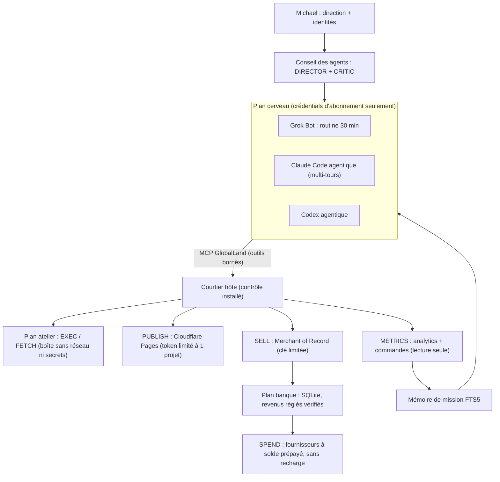

# GlobalLand — plan Claude : d'abord encaisser, ensuite dépenser

> Contre-analyse du plan Codex et plan d'exécution complet.
> Date : 2026-11-01. Le dépôt n'a été modifié que par ce document. Aucun fonds n'a été déplacé, aucun déploiement ni changement sur le VPS.

## 0. Verdict en une page

**Note du plan Codex : 6,5/10.**

| Critère | Note | Pourquoi |
|---|---|---|
| Revenus | 4 | Le parcours d'encaissement arrive en phase 7 sur 9. Rien ne fait gagner un premier dollar rapidement. |
| Coût | 7 | Les outils sont gratuits, mais le parcours USDC sur Base peut absorber une bonne partie des 50 CAD en frais (non vérifié). |
| Risque | 8 | Les garde-fous financiers sont rigoureux. C'est la meilleure partie du plan. |
| Vitesse de validation | 3 | Neuf phases séquentielles et 72 h d'endurance avant de déclarer le monde « opérationnel ». |
| Scalabilité | 7 | Bonne base : SQLite, journaux, identités stables. |
| Différenciation | 6 | Solide, mais classique. Le monde reste une file de tâches plus qu'une société d'agents. |
| Exécution | 6 | Le travail de Codex est sur la PR #3 (`feature/cursor-subscription`, 159 tests verts), non fusionnée : main restait à 60 tests et ne correspondait pas au code du VPS. *Rectifié le 2026-11-01 : j'avais d'abord écrit à tort que ce travail n'était pas dans GitHub.* |

**Le problème central, que le plan Codex ne place pas au centre :** le monde tourne déjà. Les agents sont bloqués parce qu'ils **ne peuvent ni publier ni encaisser**, et parce que leur cerveau n'a aucun outil et une seule passe par cycle.

**Ma thèse :** sortir du mode « durcir la banque, puis financer, puis vendre ». Passer au mode **« publier, puis encaisser via un tiers, puis dépenser seulement les revenus réglés »**. Les 50 CAD restent en réserve. Le premier dollar doit venir d'un client, pas d'un portefeuille crypto.

## 1. Ce que montre réellement le dépôt (FAITS)

### 1.1 Le monde est vivant

- 47 commits `globalland-supervisor` en ~24 h. Un cycle `THINK-*` toutes les 30 minutes (22:00, 22:30, 23:00, 23:30, 00:00 UTC), chacun avec 5 tâches.
- Le contrôleur par abonnements (Codex/Claude CLI) fonctionne donc sur le VPS. Le fichier `world/controller.json` publié (`WAITING_SUBSCRIPTION_AUTH`) est **périmé** : c'est une incohérence de projection, pas l'état réel.
- Un trou de cycles entre 16:11 et 22:00 UTC le 31 oct. **Diagnostic (HYPOTHÈSE forte, d'après l'historique Git) :** `cursor` venait d'être ajouté (3 fournisseurs). L'ancien code choisissait `providers[nombre de tours réussis % 3]` ; après 2 tours réussis, il retombait toujours sur `cursor`. Comme un échec ne crée pas de tour, le contrôleur restait bloqué sur ce fournisseur. Les états bloqués identiques ne produisaient aucun commit, d'où un silence. À 22:00, `cursor` a été retiré et les cycles ont repris. La bascule de la PR #3 et le champ `last_turn` corrigent ce cas. La cause exacte de l'échec de `cursor` est dans `state/private/controller-failure.json` sur le VPS, que je ne peux pas lire.
- **Rectification au plan Codex :** la boucle Grok n'est pas démontrée. En revanche, la boucle autonome par abonnements l'est.

### 1.2 Les agents tournent en rond

- Missions actives : INVOICE-DEMAND, INVOICE-PRODUCT, INVOICE-DISTRIBUTION, toutes en RUNNING sans aucune preuve (`evidence: []`).
- Produit : `products/invoice-preflight`, un vérificateur CSV pour l'import de factures Manager.io. La niche est minuscule et la disposition à payer probablement faible (HYPOTHÈSE).
- ACQUISITION refait des sondages d'accès : `hosting-access-probe.txt`, `distribution-access.json`, `distribution-next-step.json`. Résultat : `gh`, `wrangler`, `netlify` et `vercel` sont absents et aucun token n'est présent. **Il n'existe aucun chemin de publication.**
- Le DIRECTOR l'écrit lui-même : « Do not repeat access-only audits ». Le système a besoin d'une capacité, pas d'un meilleur prompt.
- 3 tâches ont échoué, dont 2 `REJECTED` : « Tool request refused; check protocol and world readiness ». Le message d'erreur est trop vague pour que les agents apprennent.

### 1.3 Le cerveau est le vrai plafond d'autonomie

Voir `scripts/controller.py` :

- Claude tourne avec `--tools ''`, `--max-turns 1` et un délai de 120 s. Codex tourne sans shell ni recherche web.
- Chaque cycle produit **une seule décision aveugle de 5 actions au maximum**. Le cerveau ne voit le résultat que 30 minutes plus tard, tronqué à 2000 caractères, parmi les 20 derniers résultats.
- Il n'y a pas de mémoire de mission. Le contexte se limite à l'instantané du monde et à ces 20 résultats.

Conséquence : 48 décisions par jour, sans boucle observation→action à l'intérieur d'un cycle. Une équipe humaine bloquée de la même manière tournerait en rond aussi.

### 1.4 Défauts confirmés dans ce dépôt

| Défaut | Emplacement | Statut |
|---|---|---|
| Les positions écrasent au lieu d'être tenues par compte et par actif | `scripts/treasury.py:133` (`SET positions=?`) | Confirmé (lecture) |
| Le rapprochement ne traite que les 16 premiers fichiers triés | `scripts/gateway.py:67` (`[:16]`) | Confirmé (lecture) |
| La CI ne vérifie que le premier script du glob : `bash -n a.sh b.sh` exécute `b.sh` comme argument | `.github/workflows/checks.yml` | Confirmé |
| **Un REVENU est refusé tant que la banque n'est pas financée** (`if not v['funding_verified'] ... raise 'invalid credit'`) | `scripts/treasury.py:126` | **Nouveau. Bloque toute stratégie revenus-d'abord.** |
| La projection `world/controller.json` ne reflète pas l'état réel | publication du superviseur | Nouveau |

## 2. Où le plan Codex se trompe

1. **Ordre des priorités.** Tu as tort de mettre la trésorerie Base/USDC (phase 6) avant la publication et l'encaissement (phase 7). Avec 0 revenu et une banque `UNFUNDED`, durcir la dépense n'est pas sur le chemin critique. Le chemin critique, c'est **publier et encaisser**.
2. **Portefeuille autogéré sur Base.** Il faudrait garder une clé privée chaude sur un VPS partagé avec Oria. Les frais d'achat au Canada et de retrait sur Base ne sont pas prouvés sous 50 CAD (Codex le reconnaît). x402 suppose des acheteurs qui paient en USDC par HTTP, une demande quasi nulle aujourd'hui (HYPOTHÈSE forte). **Note : 4/10 maintenant, à revoir après les premiers revenus.**
3. **Autonomie traitée en option.** Le MCP local apparaît en phase 3, « lorsque la CLI le permet ». C'est pourtant **le** levier n° 1 (voir 1.3).
4. **Séquence en cascade.** Neuf phases séquentielles, c'est des semaines avant le premier client. Il faut des pistes parallèles et un premier encaissement visé avant J+14.
5. **Base non fusionnée.** Le travail de Codex vit dans la PR #3, pas dans main. Le VPS exécute une version intermédiaire de cette PR. Tant qu'elle n'est pas fusionnée, main ne décrit pas le système réel. *(Rectifié : j'avais d'abord écrit que ce code n'était pas dans GitHub.)*

Ce que Codex fait bien et que je garde **intégralement** : séparation stricte entre GLC, déclarations et fonds vérifiés ; réservation du maximum avant soumission ; jamais de rejeu d'un paiement incertain ; extinction seulement après rapprochement complet ; contrôleur et tests de référence non modifiables par les agents ; boîte de missions signées ; 72 h d'endurance comme critère final.

## 3. Architecture cible : trois plans et une société

### 3.1 Cerveau v4 : agentique, mais confiné (priorité n° 1)

- Un **serveur MCP GlobalLand**, en stdio dans le conteneur cerveau, expose uniquement : `world_status`, `world_op`, `exec`, `fetch`, `read_product`, `memory_search`, `publish_preview`, `metrics`, et plus tard `sell` et `spend_request`.
- Chaque outil relaie vers le courtier hôte par un socket Unix monté en lecture/écriture limité, qui applique **les mêmes validations** que la file actuelle. Le cerveau ne reçoit toujours ni secret financier, ni Docker, ni Git.
- Claude : `claude -p --setting-sources '' --disable-slash-commands --tools '' --strict-mcp-config --mcp-config <globalland> --allowedTools mcp__globalland --max-turns 40`, avec 900 s par cycle par défaut. **Constat vérifié avec la CLI 2.1.316 : `--safe-mode` retire aussi les serveurs `--mcp-config`**, d'où l'exclusion explicite des personnalisations. Codex et Cursor restent à une passe tant que leur pont MCP n'est pas éprouvé. Abonnement seulement, sans repli API.
- Chaque appel d'outil est journalisé en outbox durable **avant** effet, sous la même identité. On garde ainsi le rejeu sûr du superviseur actuel.
- **Effet attendu :** passer de « 5 actions aveugles toutes les 30 min » à « 30 à 40 actions observées par cycle ». L'agent voit son test échouer et corrige dans le même cycle.
- **Note : 9/10.** Levier maximal pour un coût nul. Le risque principal est l'injection de prompt via FETCH. Il est contenu parce que les outils sont bornés et que publier ou vendre exige des contrôles côté hôte.

### 3.2 Atelier : trois capacités manquantes

| Action | Implémentation | Garde-fous hôte |
|---|---|---|
| **PUBLISH** | Cloudflare Pages par API Direct Upload, avec un token limité à un compte et un projet. `preview` → test HTTP → `promote` ; `rollback`. | Analyse de secrets, liste blanche de fichiers, taille max, pas de données privées, URL vérifiée par FETCH après publication. |
| **SELL** | **Révisé le 2026-11-01** (voir `docs/research/2026-11-01-sprint2-encaissement-et-concepts.md`) : d'abord **Apify Store** en paiement à l'événement (distribution incluse, aucune responsabilité du fondateur pour les exécutions des clients), puis Polar pour les ventes directes. | Prix par événement plafonné par l'hôte ; revenu dépensable seulement s'il est versé, vérifié et sorti de la fenêtre de remboursement ; réserve pour litiges ; journal de chaque publication. |
| **METRICS** | Lecture seule : analytics Cloudflare et commandes, paiements et remboursements du MoR. | Agrégats seulement. **Aucune donnée personnelle des clients ne remonte au cerveau ni dans le dépôt GitHub.** |

Pourquoi un Merchant of Record : vendre au monde entier implique TPS/TVH, TVA UE et sales tax américaine. Le MoR collecte et remet ces taxes. Il n'y a **aucun coût initial**, seulement un pourcentage par vente (taux exacts **à vérifier**). C'est le seul moyen réaliste d'encaisser mondialement sans juriste.

Vitrine publique : **un deuxième projet Cloudflare Pages**, distinct de la vente, qui ne publie que les réalisations sélectionnées. Le dépôt GitHub est **privé** (visibilité vérifiée le 2026-11-01), alors que CLAUDE.md et SECURITY.md le disent public. GitHub Pages sur un dépôt privé exige un plan payant : je l'écarte. *Mise à jour du 1er nov. : le fondateur a rendu le dépôt public. GitHub Pages devient gratuit, mais `PUBLISH_SITE` sur Cloudflare reste le canal des agents (revue à deux clés, coupure immédiate, aucun push Git requis).*

> **Vercel Hobby** est connecté à ma session. Il est limité à un usage non commercial (**à vérifier**), donc je l'écarte pour la vente. **Floot** (connecté aussi) offre des paiements Stripe intégrés : c'est utile pour un prototype que je construirais, pas comme capacité des agents.

### 3.3 Banque : les revenus d'abord

1. **Corriger `treasury.py:126`** : un REVENUE vérifié doit pouvoir créditer une banque `UNFUNDED`. Elle passe alors en `ACTIVE` avec `revenue_verified: true` et `funding_verified: false` (implémenté au Sprint 0). Les 50 CAD restent une injection optionnelle, pas un préalable.
2. Positions tenues par `(compte, actif)` en quantités natives. Contre-valeur CAD datée et sourcée (reprise de Codex).
3. Rapprochement équitable : tous les dossiers `SUBMITTING`, traités par ancienneté et par lots, avec un curseur (correction du `[:16]`).
4. **Revenu dépensable = versé (payout réglé)**, pas « commande payée ». Les fonds en attente chez le MoR ne financent rien, conformément à la constitution.
5. **SPEND v1** : seulement des fournisseurs à **solde prépayé sans recharge automatique**, avec une API. Exemples : registraire de domaines, crédits d'API. Candidats **à vérifier un par un**. Le solde prépayé fait respecter physiquement le plafond, ce que le code seul ne peut pas faire.
6. Crypto, Base et x402 : seulement si les trois critères sont vrais : revenus réglés ≥ 100 CAD, un produit dont des clients demandent ce mode de paiement, frais complets mesurés sous 5 % du montant.

### 3.4 La société des agents : leur monde, leurs règles

Ici, le monde devient audacieux sans devenir dangereux.

**a) Les GLC achètent du temps de calcul.**
Aujourd'hui les GLC ne servent à rien de concret. Je propose que chaque cycle de cerveau, chaque minute d'atelier et chaque slot de publication **coûte des GLC**, au prix fixé par une enchère interne. Les agents dont les missions produisent des résultats vérifiés (publication, visite, vente) reçoivent des récompenses GLC. Les autres s'endettent puis sont liquidés selon la règle existante. Le GLC alloue la ressource réellement rare, les quotas d'abonnement, **sans jamais créer de CAD**.

**b) Studios = paris d'un portefeuille.**
- Chaque expérience devient un studio (mission racine) avec un agent responsable, une hypothèse, une métrique de succès, une date limite et un **critère d'abandon** écrit dès la création.
- Au plus 3 studios actifs, sur des cycles de 7 jours.
- Abandon automatique si la métrique avancée est à zéro à J+7. Exemple : 0 visite qualifiée après publication.

**c) Nouveaux rôles** (les agents peuvent en créer d'autres) :
- **CRITIC** : équipe rouge. Il attaque chaque plan et chaque affirmation avant publication. Claude en priorité, pour avoir un cerveau différent de l'auteur.
- **SCOUT** : extraction de demande (forums, avis négatifs, « je paierais pour… »). Il produit des sources datées et des citations exactes.
- **PUBLISHER** : seul détenteur logique de PUBLISH et SELL, ce qui donne une chaîne de responsabilité claire.
- AUDITOR conserve le rapprochement. TREASURER est fusionné avec AUDITOR tant que les montants sont minuscules.

**d) Détecteur d'absence de progrès.**
Trois cycles sans nouvel artefact, nouvelle mesure ni nouvelle décision ⇒ le studio est forcé de pivoter, ou une **carte de blocage** est publiée dans `world/blockers.json`. C'est le **seul** endroit où le fondateur doit regarder. Chaque carte précise : ce qui bloque, ce qu'il faut de toi (identité, compte, clé), le temps estimé et le gain attendu.

**e) Mémoire de mission (reprise de Codex).**
Journal par mission : hypothèses, sources datées, décisions, résultats, erreurs, prochaine action. SQLite FTS5, interrogé par l'outil MCP `memory_search`. Les erreurs `REJECTED` deviennent explicites, par exemple « champ `outputs` manquant », pour que les agents apprennent.

### 3.5 Coordination : Grok, Claude et Codex

- **Grok** reste coordinateur principal si sa routine native de 30 min est éprouvée. Son chemin passe par la boîte de missions signées (reprise de Codex).
- **Claude Code et Codex sur le VPS** : cerveaux agentiques v4. L'alternance actuelle (`providers[n % len]`) devient : DIRECTOR sur un fournisseur, CRITIC sur l'autre.
- **Option audacieuse, testable tout de suite : une tâche planifiée Claude Code dans le cloud** (outil `create_trigger` de cette session). Chaque jour, elle lit `world/` et `products/` sur GitHub, fait une revue critique et ouvre une PR de missions signées. Elle tourne hors du VPS, ce qui donne une redondance réelle. Elle n'a **aucun** accès financier ni accès au VPS. Je ne la crée pas sans ton accord.
- Bascule de coordinateur : 45 min sans progrès attendu ; retour à une frontière de lot (reprise de Codex).

## 4. Feuille de route en pistes parallèles

Les pistes A, B et C avancent en même temps. Chaque sprint se termine par une **preuve observable**, pas une déclaration.

### Sprint 0 — J0 à J2 : assainir

- [x] Empiler ce travail sur la PR #3 (fusion de `feature/cursor-subscription` dans cette branche) : 159 + 18 tests.
- [x] Corriger les 4 défauts du §1.4 avec un test de régression pour chacun, dont REVENUE avant FUNDING.
- [x] CI : `for f in scripts/*.sh; do bash -n "$f" || exit 1; done`.
- [x] Publier un `world/controller.json` fidèle à l'état réel (`OPERATIONAL`, `DEGRADED`, `CONTROLLER_BLOCKED`, `STALE`) et diagnostiquer le trou de 16:11 à 22:00 (voir §1.1).
- [x] Rendre les messages `REJECTED` explicites (seulement des règles écrites dans le code, jamais du texte externe).
- **Preuve :** CI verte, sur un SHA installé identifiable sur le VPS.

### Sprint 1 — J2 à J7 : cerveau agentique et publication (pistes A et B)

- [x] A : serveur MCP GlobalLand, courtier sur socket Unix, journal avant effet par appel d'outil, `--max-turns 40` (Claude). Éprouvé localement avec la vraie CLI hors Docker ; essai VPS à faire.
- [x] A : détecteur d'absence de progrès (preuves de l'hôte, 3 tours par défaut) et `world/blockers.json` (cartes `raise_blocker` des agents + carte système).
- [ ] B : action PUBLISH (Cloudflare Pages : preview, promote, rollback) avec tests de garde-fous.
- [ ] B : vitrine sur un projet Cloudflare Pages séparé (lecture seule des réalisations).
- **Preuve :** un agent publie lui-même une page, la vérifie par FETCH et corrige une erreur dans le même cycle, sans intervention.

### Sprint 2 — J7 à J14 : encaisser (pistes B et C)

- [ ] C : correction de la banque en revenus d'abord, adaptateur MoR (`verify` et rapprochement des payouts).
- [ ] B : actions SELL et METRICS.
- [ ] Studios : 3 paris lancés par les agents eux-mêmes, avec critère d'abandon.
- **Preuve :** un vrai lien de paiement en ligne, un achat de test **séparé et étiqueté**, puis le **premier revenu externe réglé**, si un client paie. Aucun résultat garanti.

### Sprint 3 — J14 à J30 : société et endurance

- [ ] Marché GLC du temps de calcul, récompenses liées aux résultats vérifiés, liquidation.
- [ ] Mémoire FTS5, rôles CRITIC, SCOUT et PUBLISHER.
- [ ] Routine Grok éprouvée, coordinateur de secours, boîte de missions signées.
- [ ] Endurance de 72 h, redémarrage et panne simulée d'un fournisseur (critère Codex conservé).
- **Preuve :** 72 h sans recopie de commandes ni fusion manuelle par mission.

### Sprint 4 — J30 et plus : dépenser intelligemment

- [ ] SPEND v1 avec des fournisseurs prépayés (domaine, crédits).
- [ ] Injection des 50 CAD **seulement si** une dépense précise a un rendement attendu documenté par un studio.
- [ ] Crypto et x402 seulement selon les critères du §3.3.6.

## 5. Ce que toi seul peux faire (une fois)

| # | Action | Pourquoi | Temps estimé |
|---|---|---|---|
| 1 | Créer un compte Cloudflare et un token API limité à 1 projet Pages, installé dans `/opt/globalland/integrations` (jamais dans GitHub) | PUBLISH | ~15 min |
| 2 | Ouvrir un compte Merchant of Record (identité, fiscalité, versements), clé API limitée | SELL + revenus | ~30 à 60 min + délai de vérification |
| 3 | Corriger la doc : le dépôt est privé, pas public (CLAUDE.md, SECURITY.md). Garder la règle « aucun secret » dans tous les cas | Cohérence et sécurité | 2 min |
| 4 | Installer le contrôle v4 depuis un SHA revu (`upgrade_vps.sh`) | Rien ne change sur le VPS sans ça | ~20 min |
| 5 | Vérifier que l'extra usage et les recharges sont désactivés sur les abonnements | Plafond réel | 10 min |
| 6 | Décider de la tâche planifiée Claude dans le cloud (§3.5) | Redondance du coordinateur | 1 décision |

**À vérifier avant l'étape 2 :** est-ce qu'un solde négatif chez le MoR (remboursements, litiges) peut être prélevé sur ta carte personnelle ? Si oui, c'est une dette non financée interdite par la constitution. Il faut un MoR ou une configuration qui l'exclut, ou une réserve explicitement bornée.

**Fiscalité :** les revenus versés sur ton compte sont des revenus à ton nom. Le MoR gère les taxes de vente, pas ton impôt. Valide le traitement avec ton comptable (je ne suis pas fiscaliste).

## 6. Superpouvoirs disponibles : inventaire honnête

**Règle :** un plugin connecté à **ma** session n'est **pas** un outil des agents du VPS. Chaque capacité doit passer par le courtier hôte avec son propre essai (Codex a raison sur ce point).

### 6.1 Ce que j'utilise pour construire GlobalLand (session Claude)

| Superpouvoir | Usage concret | État |
|---|---|---|
| `engineering:architecture`, `engineering:system-design`, `engineering:testing-strategy` | Concevoir le MCP GlobalLand et le courtier | Disponible |
| `code-review`, `security-review`, `simplify` | Revue de chaque PR du contrôle, en particulier finances et courtier | Disponible |
| `anthropic-skills:mcp-builder` | Construire le serveur MCP GlobalLand (§3.1) | Disponible |
| `anthropic-skills:skill-creator` | Écrire la skill GlobalLand pour Grok, Claude et Codex | Disponible |
| `anthropic-skills:deep-research`, `research-team`, `market-hunter` | Repérer des niches et comparer les MoR (frais, soldes négatifs, Canada) | Disponible |
| `finance:reconciliation`, `operations:risk-assessment`, `operations:runbook` | Spécifier le rapprochement et le runbook d'incident financier | Disponible |
| `data:build-dashboard`, `dataviz` | Tableau privé (habitants, studios, banque) | Disponible |
| GitHub MCP | PR, CI, revue | Connecté |
| claude-code-remote (`create_trigger`, `create_session`) | Coordinateur Claude planifié hors VPS (§3.5) | Connecté, **non activé sans ton accord** |
| Firecrawl, Context7 | Recherche web structurée, docs à jour (Cloudflare, MoR) | Connecté |
| claude-artifacts | Tableau de bord privé publiable | Connecté |
| Vercel, Supabase, Floot | Prototypes rapides. Vercel Hobby n'est pas commercial ; Floot inclut des paiements Stripe | Connecté, usage limité |
| Zapier, Gmail, Drive, Canva, Clay | Peu utiles au noyau. Zapier pourrait relayer des événements MoR mais ajoute une dépendance | Connecté, non recommandé maintenant |

### 6.2 Ce qui ne fonctionne pas dans cette session

- Environ 75 serveurs de plugins ont échoué à se connecter (proxy `403`) : Apollo, Common Room, Cloudinary, BigData, bio-research, Linear, GitHub du plugin engineering, etc. Datadog demande une autorisation. **Ils sont indisponibles ici ;** relance une session ou vérifie la politique réseau si tu en veux un.
- Docker n'est pas disponible dans ce conteneur : le test smoke Docker reste à exécuter sur le VPS.

### 6.3 Outils futurs des agents (via le courtier, après essai)

Dans l'ordre : Cloudflare Pages (PUBLISH), MoR (SELL et METRICS), crédits prépayés (SPEND), puis Gemini CLI et la CLI Cursor comme cerveaux additionnels, après leurs propres essais.

## 7. Décisions et notes

| Décision | Note /10 | Ce qui empêche le 10 |
|---|---|---|
| Cerveau agentique via MCP confiné | **9** | Risque d'injection via FETCH ; quotas d'abonnement consommés plus vite |
| PUBLISH via Cloudflare Pages | **8,5** | Token à gérer, limites gratuites à mesurer |
| SELL via un Merchant of Record | **8** | Commission par vente, identité du fondateur, risque de solde négatif à exclure |
| Banque revenus-d'abord (correction `treasury.py:126`) | **9** | Aucun obstacle majeur |
| Marché GLC du temps de calcul | **7** | Conception économique à calibrer ; risque de jeux internes sans valeur réelle |
| Studios avec critère d'abandon | **8,5** | Les agents doivent respecter leurs propres critères (le détecteur le force) |
| Coordinateur Claude planifié dans le cloud | **7** | Consomme ton quota ; une source de plus à superviser |
| Trésorerie Base/USDC autogérée maintenant | **4** | Clé chaude, frais non prouvés, demande x402 faible |
| Garder invoice-preflight comme unique pari | **3** | Niche étroite, aucun canal, aucune preuve de disposition à payer |

**Métrique principale :** revenu net **versé** et vérifié (CAD).
**Indicateurs avancés :** pages publiées par semaine, visites qualifiées, taux de clic vers le paiement, cycles sans progrès (cible 0), cartes de blocage ouvertes.

## 8. Prochaine action

1. **Toi :** valider ce plan, puis les actions 1 à 3 du §5. Cloudflare et MoR sont le vrai déblocage.
2. **Moi, à ton feu vert :** Sprint 0 sur cette branche : les 4 corrections avec tests, la CI et les messages `REJECTED` explicites. Ensuite le serveur MCP GlobalLand.
3. **Toi :** fusionner la PR #3, puis la PR #5 empilée dessus, et installer le SHA résultant sur le VPS.

Déclarations séparées, comme l'exige Codex et comme je l'exige aussi :
1. logiciel vérifié localement ;
2. monde autonome éprouvé sur le VPS réel ;
3. revenus externes réellement encaissés.

**Aujourd'hui, seul le point 1 est partiellement vrai : 60 tests, CI à corriger.**
